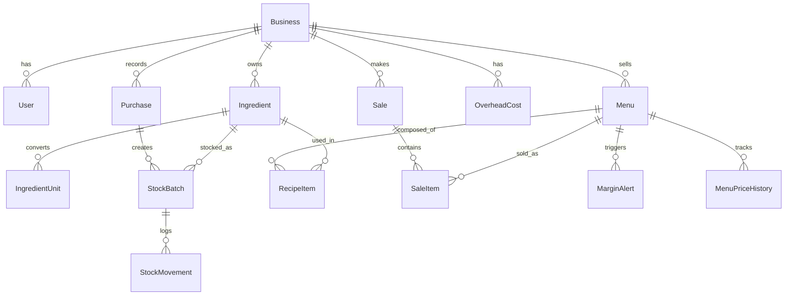

# ARCHITECTURE.md — TakarLaba

> Cetak biru teknis (Paket 1: React + Express). Versi 1.1 · 2026-10-19. Aturan bisnis: `PRD.md` §5.1 (BR-xx).

## 1. Tech Stack Overview

| Layer              | Teknologi                                                                                        | Kegunaan                                                         |
| ------------------ | ------------------------------------------------------------------------------------------------ | ---------------------------------------------------------------- |
| Frontend           | React 19 + Vite + TypeScript strict                                                              | SPA: UI, form, dashboard, POS                                    |
| Routing            | React Router v8 (data router, lazy routes)                                                       | Navigasi, code splitting per halaman                             |
| Server state       | TanStack Query v5                                                                                | Fetch, cache, loading/error state, invalidation setelah mutasi   |
| Styling & UI kit   | Tailwind CSS v4 (`@tailwindcss/vite`) + shadcn/ui + lucide-react + Sonner                        | Komponen konsisten, responsif, toast feedback                    |
| Form & validasi UX | React Hook Form + Zod 4                                                                          | Validasi sisi klien (UX); backend tetap otoritatif               |
| Charts             | Recharts                                                                                         | Scatter Menu Engineering, grafik dashboard                       |
| Backend / API      | Node.js 22 + Express 5 + TypeScript (ESM)                                                        | REST API, business logic, validasi, otorisasi                    |
| Domain logic       | `backend/src/domain` (TypeScript murni) + decimal.js                                             | Costing, FEFO, pricing, menu engineering, capacity — mudah dites |
| Validasi API       | Zod 4 (middleware `validate`)                                                                    | Validasi request di batas sistem                                 |
| Database           | PostgreSQL 17 (Neon di produksi; Docker lokal)                                                   | Relasional, transaksi ACID, row locking                          |
| ORM                | Prisma 7 + `@prisma/adapter-pg`                                                                  | Akses data bertipe, migrasi                                      |
| Auth               | Better Auth (email+password, sesi cookie httpOnly)                                               | Login, sesi, rate limiting                                       |
| Keamanan & ops     | helmet, express-rate-limit, pino / pino-http                                                     | Header, pembatasan laju, log terstruktur                         |
| Testing            | Vitest (unit & integration), supertest (HTTP), Testing Library (FE kritis), Playwright (E2E, P2) | Kualitas & regresi                                               |
| CI/CD              | GitHub Actions (job `backend` & `frontend`) + Vercel + Render                                    | Lint, typecheck, test, build, deploy                             |
| Deployment         | Frontend: Vercel · Backend: Vercel Functions (Hobby plan) atau VPS/Render · DB: Neon             | Live publik                                                      |

### Keputusan arsitektur (ADR ringkas)

- **ADR-1 Satu repo, dua aplikasi:** `frontend/` dan `backend/` berpackage.json sendiri (tanpa workspaces), plus `database/` dan `docs/`. Cocok dengan contoh struktur slide TM dan mudah diperiksa juri.
- **ADR-2 Satu origin lewat proxy:** browser hanya memanggil domain frontend; Vercel me-_rewrite_ `/api/*` ke backend (`vercel.json`). Alasan: cookie sesi tetap _first-party_ (Safari memblokir cookie lintas-situs), tanpa CORS. Di dev, Vite me-_proxy_ `/api` → `localhost:4000`. **Plan B** bila uji Safari gagal (T-017): domain kustom dengan subdomain yang sama, atau Better Auth bearer plugin (konsekuensi keamanan dicatat di ADR baru).
- **ADR-3 Backend otoritatif:** validasi, otorisasi, dan semua rumus ada di backend. Frontend tidak menduplikasi logika; _live preview_ HPP memanggil `POST /api/menus/preview-cost` (debounce 300 ms).
- **ADR-4 Domain murni terpisah dari I/O:** rumus bisnis dites tanpa DB dan menjadi bukti arsitektur yang masuk akal.
- **ADR-5 Multi-tenant-ready sejak awal:** `businessId` di semua tabel bisnis.
- **ADR-6 Dua HPP:** _Aktual_ (biaya batch terpakai → laporan laba) dan _Pengganti_ (harga beli terbaru → alert & analitik).
- **ADR-7 Seed di backend:** `backend/src/seed` agar dipakai ulang oleh `POST /api/demo/reset`; `database/` berisi skema, migrasi, dan Docker.
- **ADR-8 Hosting backend di Vercel Functions (Hobby plan) & dual-mode:** Render mewajibkan penagihan kartu kredit dan free tier-nya tidur setelah 15 menit idle. Backend mendukung dual-mode: zero-config serverless function via `backend/src/index.ts` untuk project Vercel kedua (region `sin1`), dan standalone runner di `backend/src/standalone.ts` untuk mode lokal/VPS (lihat ADR 0002 di `docs/adr/0002-backend-on-vercel.md`). Fallback: VPS atau Render berbayar bila billing tersedia.

## 2. Project Directory Structure

```text
takarlaba/
├── AGENTS.md  CLAUDE.md  PRD.md  ARCHITECTURE.md  TODO.md  SKILL.md  WORKFLOW.md
├── README.md  LICENSE  .gitignore
├── package.json                      # script kenyamanan saja (npm --prefix …), tanpa workspaces
├── .github/workflows/ci.yml          # job backend & frontend
├── frontend/
│   ├── package.json  index.html  vite.config.ts  vercel.json  components.json
│   ├── tsconfig.json  tsconfig.app.json  tsconfig.node.json  eslint.config.js  .env.example
│   └── src/
│       ├── main.tsx  App.tsx  router.tsx  index.css      # Tailwind v4: @import + @theme
│       ├── api/
│       │   ├── client.ts             # fetch wrapper + envelope + ApiError + Idempotency-Key
│       │   ├── keys.ts  types.ts     # query key factory, DTO (cermin docs/api.md)
│       │   └── hooks/                # use-ingredients, use-purchases, use-menus, use-sales, use-alerts, use-analytics, …
│       ├── pages/                    # login, dashboard, pos, ingredients, purchases, stock, menus, alerts,
│       │                             # analytics (menu-engineering), sales, settings, not-found
│       ├── components/
│       │   ├── ui/                   # shadcn
│       │   ├── shared/               # DataTable, EmptyState, ConfirmDialog, MoneyText, StatusBadge, ProtectedRoute
│       │   └── features/             # pos/, menus/, purchases/, alerts/, analytics/
│       ├── hooks/                    # use-cart (reducer), use-debounce
│       ├── lib/                      # auth-client.ts, format.ts (Rp, id-ID), money.ts (decimal preview), cn.ts
│       └── test/
├── backend/
│   ├── package.json  tsconfig.json  eslint.config.js  vitest.config.ts  prisma.config.ts  .env.example
│   ├── src/
│   │   ├── index.ts                  # single Vercel entrypoint (export default createApp())
│   │   ├── create-app.ts             # createApp() factory murni tanpa instansiasi modul
│   │   ├── standalone.ts             # entrypoint proses server lokal & VPS (listen + graceful shutdown)
│   │   ├── config/env.ts             # env divalidasi Zod, gagal cepat bila kurang
│   │   ├── lib/                      # auth.ts (Better Auth), db.ts, logger.ts, errors.ts, envelope.ts, money.ts, date.ts
│   │   ├── middleware/               # require-auth, require-role, validate, same-origin, rate-limit, request-id, error-handler, not-found
│   │   ├── routes/                   # index.ts + *.routes.ts per fitur (tipis)
│   │   ├── services/                 # orkestrasi DB + domain (inventory, purchase, sales, price-shock, analytics, demo)
│   │   ├── repositories/             # satu-satunya tempat Prisma dipanggil; terscope businessId
│   │   ├── validation/               # skema Zod per use-case (*.schema.ts)
│   │   ├── dto/                      # mapper respons per peran (OWNER vs CASHIER)
│   │   ├── domain/                   # PURE: costing, fefo, pricing, capacity, menu-engineering, waste, units, types
│   │   ├── seed/                     # index.ts, fixtures.ts (PRD Lampiran B), demo-reset.ts
│   │   └── generated/prisma/         # output generator (di-.gitignore)
│   └── tests/                        # unit/, integration/ (DB nyata), http/ (supertest), fixtures/
├── database/
│   ├── schema.prisma                 # model, enum, index
│   ├── migrations/                   # termasuk SQL constraints manual
│   ├── sql/constraints.sql           # CHECK & partial index (dirujuk dari migrasi)
│   └── docker-compose.yml            # Postgres 17 lokal
└── docs/
    ├── erd.md                        # ERD Mermaid (+ gambar untuk proposal)
    ├── api.md                        # kontrak API (sumber kebenaran FE↔BE)
    ├── adr/                          # keputusan arsitektur
    └── screenshots/
```

**Fungsi folder kunci:** `backend/src/domain` = rumus bisnis murni (paling banyak dites) · `services` = transaksi & orkestrasi · `repositories` = satu-satunya akses Prisma · `routes` = pintu masuk HTTP (tipis) · `frontend/src/api` = satu-satunya lapisan yang berbicara ke backend · `database/` = skema & migrasi · `docs/api.md` = kontrak yang harus sinkron dengan kode.

## 3. Data Models / Database Schema

Konvensi: id `String @id @default(cuid())`; semua tabel bisnis punya `businessId` + `createdAt`; uang `Decimal(14,2)`; kuantitas `Decimal(14,3)`; biaya per base unit `Decimal(18,6)`; persen `Decimal(5,2)`. Tabel auth (user, session, account, verification, rateLimit) **dibuat oleh CLI Better Auth**, lalu digabung ke `database/schema.prisma`.

**Enum:** `Role {OWNER, CASHIER}` · `BaseUnit {G, ML, PCS}` · `IngredientCategory {MAIN, SUPPORT, PACKAGING}` · `MovementType {PURCHASE, SALE, VOID_RESTORE, WASTE, ADJUSTMENT}` · `SaleStatus {COMPLETED, VOIDED}` · `PaymentMethod {CASH, QRIS, TRANSFER}` · `OverheadType {UTILITY, LABOR, DEPRECIATION, OTHER}` · `AlertStatus {OPEN, ACKNOWLEDGED, RESOLVED}` · `AlertResolution {PRICE_RAISED, RECIPE_ADJUSTED, DISMISSED, AUTO_RESOLVED}` · `PriceChangeReason {MANUAL, PRICE_SHOCK_ALERT}`

| Entity                 | Field utama (tipe)                                                                                                                                                                                                                                                                                              | Constraint / Index                                                                                  |
| ---------------------- | --------------------------------------------------------------------------------------------------------------------------------------------------------------------------------------------------------------------------------------------------------------------------------------------------------------- | --------------------------------------------------------------------------------------------------- |
| **Business**           | id, name, isDemo (bool), targetMarginDefault (5,2 =50), expiryWarnDays (int =3), priceRoundingStep (int =500), expectedMonthlyPortions (int =1000), wastePromoMinMargin (5,2 =10), timezone (str =Asia/Jakarta), demoResetAt (dt?)                                                                              | `expectedMonthlyPortions ≥ 1`                                                                       |
| **User** (Better Auth) | id, name, email, emailVerified, role (Role), businessId, isActive (bool), createdAt                                                                                                                                                                                                                             | unique(email); index(businessId)                                                                    |
| **Ingredient**         | id, businessId, name, nameKey, category, baseUnit, yieldPercent (5,2 =100), isPerishable (bool), minStockBase (14,3 =0), isActive                                                                                                                                                                               | unique(businessId, nameKey); CHECK yield 1–100; baseUnit immutable setelah dipakai (cek di service) |
| **IngredientUnit**     | id, ingredientId, name, toBaseFactor (14,4)                                                                                                                                                                                                                                                                     | unique(ingredientId, name); CHECK factor > 0                                                        |
| **Purchase**           | id, businessId, supplierName?, purchasedAt, note?, totalAmount (14,2), createdById                                                                                                                                                                                                                              | index(businessId, purchasedAt)                                                                      |
| **StockBatch**         | id, businessId, ingredientId, purchaseId, receivedAt, expiryDate (DATE?), purchaseQty (14,3), purchaseUnit (str), purchaseUnitPrice (14,2), initialQtyBase (14,3), remainingQtyBase (14,3), costPerBase (18,6)                                                                                                  | CHECK remaining ≥ 0 AND ≤ initial; CHECK initial > 0; index FEFO partial (remaining > 0)            |
| **StockMovement**      | id, businessId, ingredientId, batchId, type, qtyBaseDelta (14,3), costPerBase, refType?, refId?, note?, createdById, createdAt                                                                                                                                                                                  | index(businessId, createdAt); index(refType, refId)                                                 |
| **Menu**               | id, businessId, name, nameKey, category?, sellingPrice (14,2), targetMargin (5,2)?, isActive                                                                                                                                                                                                                    | unique(businessId, nameKey); CHECK price > 0                                                        |
| **RecipeItem**         | id, menuId, ingredientId, qtyUsableBase (14,3)                                                                                                                                                                                                                                                                  | unique(menuId, ingredientId); CHECK qty > 0                                                         |
| **OverheadCost**       | id, businessId, name, type, monthlyAmount (14,2), isActive                                                                                                                                                                                                                                                      | CHECK amount ≥ 0                                                                                    |
| **MenuPriceHistory**   | id, menuId, oldPrice, newPrice, reason, alertId?, changedById, changedAt                                                                                                                                                                                                                                        | index(menuId, changedAt)                                                                            |
| **Sale**               | id, businessId, invoiceNo, idempotencyKey, soldAt, cashierId, paymentMethod, totalAmount (14,2), totalIngredientCost (14,2), totalOverhead (14,2), status, voidedAt?, voidReason?, voidedById?                                                                                                                  | unique(businessId, invoiceNo); unique(businessId, idempotencyKey); index(businessId, soldAt)        |
| **SaleItem**           | id, saleId, menuId, menuNameSnapshot, qty (int), unitPrice (14,2), ingredientCostActual (14,2), overheadAllocated (14,2)                                                                                                                                                                                        | CHECK qty > 0; index(menuId)                                                                        |
| **MarginAlert**        | id, businessId, menuId, status, resolution?, triggerPurchaseId?, triggerIngredientId?, ingredientCostBefore/After (18,6), fullCostBefore/After (14,2), marginBeforePct/AfterPct/targetPct (5,2), sellingPriceAtTrigger (14,2), recommendedPrice (14,2), createdAt, updatedAt, resolvedAt?, resolvedById?, note? | **partial unique** (menuId) WHERE status = 'OPEN'                                                   |

`invoiceNo` = `INV-YYYYMMDD-XXXXXX` (6 karakter acak) untuk menghindari race counter. HPP, kapasitas, kuadran Menu Engineering, dan Waste Radar adalah **turunan** (dihitung), bukan tabel.

**Constraints manual (`database/sql/constraints.sql`, disisipkan lewat `prisma migrate dev --create-only`):**

```sql
ALTER TABLE "StockBatch" ADD CONSTRAINT stock_batch_qty_chk
  CHECK ("remainingQtyBase" >= 0 AND "remainingQtyBase" <= "initialQtyBase" AND "initialQtyBase" > 0);
ALTER TABLE "Ingredient" ADD CONSTRAINT ingredient_yield_chk CHECK ("yieldPercent" BETWEEN 1 AND 100);
ALTER TABLE "RecipeItem" ADD CONSTRAINT recipe_qty_chk CHECK ("qtyUsableBase" > 0);
ALTER TABLE "Menu" ADD CONSTRAINT menu_price_chk CHECK ("sellingPrice" > 0);
ALTER TABLE "SaleItem" ADD CONSTRAINT sale_item_qty_chk CHECK (qty > 0);
CREATE UNIQUE INDEX margin_alert_one_open_per_menu ON "MarginAlert"("menuId") WHERE status = 'OPEN';
CREATE INDEX stock_batch_fefo_idx ON "StockBatch"("businessId","ingredientId","expiryDate","receivedAt")
  WHERE "remainingQtyBase" > 0;
```

**ERD:**



**Konfigurasi Prisma 7 (verifikasi dengan docs saat T-006):**

```prisma
// database/schema.prisma
generator client {
  provider     = "prisma-client"
  output       = "../backend/src/generated/prisma"
  moduleFormat = "esm"
  // importFileExtension = "ts"   // aktifkan hanya bila tsx error "Cannot find module './internal/class.js'"
}
datasource db { provider = "postgresql" }
```

```ts
// backend/prisma.config.ts
import "dotenv/config";
import { defineConfig, env } from "prisma/config";
export default defineConfig({
  schema: "../database/schema.prisma",
  migrations: { path: "../database/migrations", seed: "tsx src/seed/index.ts" },
  datasource: { url: env("DIRECT_URL") }, // CLI & migrasi: koneksi langsung
});
```

```ts
// backend/src/lib/db.ts  (runtime: koneksi pooled)
import { PrismaPg } from "@prisma/adapter-pg";
import { PrismaClient } from "../generated/prisma/client.js";
import { env } from "../config/env.js";
export const prisma = new PrismaClient({
  adapter: new PrismaPg({ connectionString: env.DATABASE_URL }),
});
```

## 4. Implementation Phases

| Fase                              | Tanggal                    | Deliverable                                                                                                                                                                                                                  | Acceptance Criteria                                                                                                                                                                                 |
| --------------------------------- | -------------------------- | ---------------------------------------------------------------------------------------------------------------------------------------------------------------------------------------------------------------------------- | --------------------------------------------------------------------------------------------------------------------------------------------------------------------------------------------------- |
| **0. Setup & deploy awal**        | 19–20 Okt                  | Repo publik; scaffold `frontend` (Vite+Tailwind4+shadcn+Router+Query) dan `backend` (Express 5 ESM, env, logger, helmet, error envelope, `/api/health`); Prisma 7 + Docker; CI; deploy Neon + Render + Vercel dengan rewrite | URL frontend tampil; `GET /api/health` **lewat domain frontend** mengembalikan `{ok:true}`; CI hijau di kedua folder; spike build+start backend dengan client Prisma lulus; `.env` tidak ter-commit |
| **1. Auth, tenant, shell**        | 20–22 Okt                  | Better Auth di Express, middleware (auth/role/validate/origin/error), tenant ctx, login UI + guard rute, app shell responsif, core libs, seed v0, **uji cookie via proxy**                                                   | Login/logout/refresh sesi lulus di **Chrome, Firefox, Edge, Safari**; kasir diarahkan ke POS; tes tenant isolation & RBAC (supertest) lulus                                                         |
| **2. Bahan & stok**               | 22–25 Okt                  | Endpoint + halaman: bahan + konversi satuan, pembelian multi-baris → batch, ringkasan stok + badge kedaluwarsa                                                                                                               | AC FR-ING-01/02, FR-PUR-01; unit test konversi & yield; rollback pembelian gagal teruji                                                                                                             |
| **3. Menu, resep, costing**       | 26–28 Okt                  | Overhead, CRUD menu, `domain/costing.ts`, `POST /menus/preview-cost`, editor resep dengan live HPP                                                                                                                           | HPP fixture A **persis** (7.740 / 8.940); badge margin; label "harga bahan belum lengkap" benar                                                                                                     |
| **4. POS + FEFO**                 | 29 Okt–1 Nov               | `domain/fefo.ts`, `POST /sales` atomik + idempotency, UI POS, struk, riwayat                                                                                                                                                 | AC FR-POS-01/02; test: urutan FEFO, rollback stok kurang, 2 checkout paralel, idempotensi                                                                                                           |
| **5. Price Shock + dashboard v1** | 2–3 Nov                    | `domain/pricing.ts`, evaluasi saat pembelian, Pusat Peringatan, terapkan harga, dashboard dasar                                                                                                                              | Skenario PRD Lampiran A langkah 1–4 menghasilkan angka persis (45,3% → Rp20.000; opsi B 115 ml)                                                                                                     |
| **6. Analitik**                   | 4–6 Nov                    | Kapasitas & bottleneck, Menu Engineering (domain + endpoint + chart + tabel + rekomendasi)                                                                                                                                   | Fixture B 6/6 benar sebelum & sesudah price shock; guard data minimum                                                                                                                               |
| **7. Hardening & polish**         | 7–8 Nov                    | Seed penuh + tombol demo, UX polish, responsif & lintas browser, security review, Lighthouse + bundle size, void & waste log                                                                                                 | Checklist SKILL.md §2 lulus; demo ≤ 5 menit tanpa error; Lighthouse sesuai target                                                                                                                   |
| **8. Submit**                     | 9 Nov (batas 10 Nov 23:59) | README final, ERD, screenshot, proposal PDF, video 3–5 menit, surat keaslian, Google Form                                                                                                                                    | Semua tautan publik & dapat diakses; `GTNIC2026_WebDev_NamaTim.pdf`                                                                                                                                 |

Dokumentasi, proposal, dan skrip video dikerjakan **paralel** mulai Fase 3. Stretch (P2): Waste Radar, CSV, E2E. **Frontend & backend dikerjakan paralel per fitur** menggunakan `docs/api.md` sebagai kontrak.

## 5. Core Algorithms (spesifikasi logika)

### 5.1 Checkout FEFO atomik (`POST /api/sales` → `services/sales.service.ts`)

```text
checkout(input{items[{menuId,qty}], paymentMethod}, header Idempotency-Key, ctx{businessId,userId}):
  validate (Zod): items 1..50, qty int 1..999, gabungkan menuId duplikat
  prisma.$transaction(async tx => {                      // timeout dinaikkan (mis. 15 dtk)
    existing = Sale by (businessId, idempotencyKey) → return existing (tanpa efek samping)
    menus = load aktif + resep + yieldPercent; error jika tidak ada/nonaktif/tanpa resep
    need[ingredientId] += qty × recipeQtyUsable × 100 / yieldPercent        // BR-02
    for ingredientId in sorted(need.keys):               // urutan tetap → cegah deadlock
      batches = $queryRaw`SELECT ... FROM "StockBatch"
                WHERE "businessId"=${b} AND "ingredientId"=${i} AND "remainingQtyBase" > 0
                  AND ("expiryDate" IS NULL OR "expiryDate" >= ${todayWIB})
                ORDER BY "expiryDate" ASC NULLS LAST, "receivedAt" ASC, id ASC FOR UPDATE`
    for item in items (urutan tetap), for ingredient in item.recipe:
      allocations = allocateFefo(batches (mutable in-memory), rawNeeded)    // domain/fefo.ts murni
      if shortage → throw InsufficientStockError{ingredient, needed, available}  // rollback total (409)
      ingredientCostActual(item) += Σ alloc.qty × batch.costPerBase
    update batches (sisa), insert StockMovement(SALE, delta negatif, costPerBase, refType='SALE_ITEM')
    overheadAllocated(item) = qty × overheadPerPortion                       // snapshot saat jual
    insert Sale + SaleItem (+ invoiceNo acak)
  })
```

Batch dengan `expiryDate == hari ini` masih valid sampai akhir hari (WIB).

### 5.2 Pembelian & Price Shock (`purchase.service.ts` + `price-shock.service.ts`)

```text
createPurchase(input, ctx):
  validate; konversi qty → base via unit factor; costPerBase = unitPrice / factor
  tx:
    before = replacementCostMap(businessId)              // sebelum insert
    insert Purchase + StockBatch + StockMovement(PURCHASE)
    after  = replacementCostMap(businessId)
    changed = ingredients where before[i] ≠ after[i] AND before[i] ada
    for menu in activeMenusUsing(changed):
      costBefore = computeMenuCost(menu, before); costAfter = computeMenuCost(menu, after)
      if marginPenuh(costAfter) < target(menu): upsert MarginAlert(OPEN) + snapshot + recommendedPrice (BR-06)
      else if ada alert OPEN: resolve(AUTO_RESOLVED)
  return { purchase, alerts }                            // FE: toast + modal dampak
reevaluateAlertsForMenu(menuId) juga dipanggil saat: resep, harga jual, overhead, target margin berubah
applyRecommendedPrice(alertId, newPrice): tx → update Menu.sellingPrice, insert MenuPriceHistory(PRICE_SHOCK_ALERT), resolve(PRICE_RAISED)
```

### 5.3 Menu Engineering (`domain/menu-engineering.ts`)

```text
input: rows[{menuId, price, fullCostReplacement, units, ageDays}], minMenus=4, minTransactions=30
eligible = rows where units>0 AND ageDays>=14 AND biaya lengkap; n = |eligible|
if n < minMenus OR totalTransactions < minTransactions → { status: 'INSUFFICIENT_DATA' }
CM_i = price_i − cost_i ; total = Σ units
popThreshold = 0.7 × (1/n) × total ; marginThreshold = Σ(CM_i × units_i) / total
quadrant = (units ≥ popThreshold, CM ≥ marginThreshold) → STAR | PLOWHORSE | PUZZLE | DOG
extras: plowhorse breakeven drop = 1 − CM/(CM+Δ) ; puzzle safeDiscount = CM − marginThreshold
        dog: bahan unik (dipakai hanya menu ini) + nilai stok
```

Sumber data: `SaleItem` status COMPLETED dalam periode (WIB), menu aktif, HPP Pengganti Penuh saat ini.

### 5.4 Kapasitas (`domain/capacity.ts`)

`rawPerPorsi_i = recipeQty_i × 100 / yield_i` · `stokValid_i = Σ remaining batch tidak kedaluwarsa` · `kapasitas = floor(min(stokValid_i / rawPerPorsi_i))` · bottleneck = argmin. Dihitung dengan satu query agregat per bisnis (hindari N+1).

## 6. Kontrak API

**Konvensi:** JSON; prefix `/api`; field `camelCase`; Decimal & uang sebagai **string**; waktu ISO 8601 UTC; `expiryDate` sebagai `YYYY-MM-DD`. Paginasi `?page=1&pageSize=20` → `meta: { page, pageSize, total }`.
**Envelope:** sukses `{ "ok": true, "data": …, "meta"?: … }` · gagal `{ "ok": false, "error": { "code", "message", "fieldErrors"?: { "field": ["pesan"] } } }`.
**Status:** 200/201 · 400 `VALIDATION_ERROR` · 401 `UNAUTHENTICATED` · 403 `FORBIDDEN` · 404 `NOT_FOUND` · 409 `CONFLICT` / `INSUFFICIENT_STOCK` · 429 `RATE_LIMITED` / `DEMO_COOLDOWN` · 500 `INTERNAL`.
**Header:** `POST /api/sales` wajib `Idempotency-Key` (UUID dari klien, dibuat per percobaan checkout dan dipertahankan saat retry).

| Method & Path                                                                                          | Peran                                                             | Prio | Keterangan                                                   |
| ------------------------------------------------------------------------------------------------------ | ----------------------------------------------------------------- | ---- | ------------------------------------------------------------ |
| `GET /api/health`                                                                                      | publik                                                            | P0   | Ping DB; dipantau monitor uptime                             |
| `POST /api/demo/reset`                                                                                 | publik (hanya `DEMO_MODE=true`, bisnis `isDemo`, cooldown 60 dtk) | P0   | Reset data contoh sesuai fixture                             |
| `/api/auth/*splat`                                                                                     | Better Auth                                                       | P0   | Sign-in/out, sesi                                            |
| `GET /api/me`                                                                                          | login                                                             | P0   | User + peran + bisnis (+ flag demo)                          |
| `GET/PATCH /api/settings`                                                                              | OWNER                                                             | P0   | Target margin, step, expectedMonthlyPortions, expiryWarnDays |
| `GET/POST /api/overheads`, `PATCH/DELETE /api/overheads/:id`                                           | OWNER                                                             | P0   | Biaya overhead; memicu re-evaluasi alert                     |
| `GET/POST /api/ingredients`, `GET/PATCH/DELETE /api/ingredients/:id`, `PUT /api/ingredients/:id/units` | OWNER                                                             | P0   | CRUD bahan (DELETE = soft), konversi satuan                  |
| `GET /api/inventory/summary`, `GET /api/inventory/batches`                                             | OWNER, CASHIER                                                    | P0   | Ringkasan stok agregat & batch FEFO (DTO kasir tanpa biaya)  |
| `POST /api/stock/waste`                                                                                | OWNER                                                             | P1   | Catat bahan terbuang                                         |
| `POST /api/purchases`                                                                                  | OWNER                                                             | P0   | Mengembalikan `{ purchase, alerts[] }`                       |
| `GET /api/purchases`, `GET /api/purchases/:id`, `POST /api/purchases/:id/void`                         | OWNER                                                             | P1   | Riwayat & pembatalan                                         |
| `GET/POST /api/menus`, `GET/PATCH/DELETE /api/menus/:id`, `PUT /api/menus/:id/recipe`                  | OWNER                                                             | P0   | CRUD menu & resep                                            |
| `POST /api/menus/preview-cost`                                                                         | OWNER                                                             | P0   | Live HPP dari draf resep (tanpa menyimpan)                   |
| `GET /api/menus/:id/cost`                                                                              | OWNER                                                             | P0   | Detail HPP Bahan/Penuh, Aktual/Pengganti                     |
| `GET /api/pos/menus`                                                                                   | OWNER, CASHIER                                                    | P0   | Menu + harga + kapasitas (tanpa biaya)                       |
| `POST /api/sales`                                                                                      | OWNER, CASHIER                                                    | P0   | Checkout atomik FEFO (`Idempotency-Key`)                     |
| `GET /api/sales`, `GET /api/sales/:id`                                                                 | OWNER semua; CASHIER miliknya hari ini                            | P0   | Riwayat & detail (alokasi batch untuk OWNER)                 |
| `POST /api/sales/:id/void`                                                                             | OWNER                                                             | P1   | Void + restore stok                                          |
| `GET /api/alerts`, `GET /api/alerts/:id`                                                               | OWNER                                                             | P0   | Pusat Peringatan                                             |
| `POST /api/alerts/:id/apply-price`, `POST /api/alerts/:id/dismiss`                                     | OWNER                                                             | P0   | Terapkan harga rekomendasi / abaikan + catatan               |
| `GET /api/dashboard/summary`                                                                           | OWNER                                                             | P0   | Kartu dashboard                                              |
| `GET /api/analytics/capacity`                                                                          | OWNER, CASHIER                                                    | P1   | Kapasitas & bottleneck (DTO kasir tanpa biaya)               |
| `GET /api/analytics/menu-engineering?days=30`                                                          | OWNER                                                             | P1   | Kuadran + rekomendasi terhitung                              |
| `GET /api/analytics/waste-radar`                                                                       | OWNER                                                             | P2   | Nilai risiko, menu terkait, batas diskon                     |
| `GET /api/export/sales.csv`, `/api/export/stock.csv`                                                   | OWNER                                                             | P2   | Ekspor CSV                                                   |

Dokumentasi rinci (skema request/response, error code per endpoint, contoh `curl`) hidup di `docs/api.md` dan harus selalu sinkron dengan kode.

## 7. Keamanan, Otorisasi & Deployment

**Matriks otorisasi**

| Kemampuan                                                            | OWNER | CASHIER           |
| -------------------------------------------------------------------- | ----- | ----------------- |
| POS checkout                                                         | ✅    | ✅                |
| Lihat menu (nama, harga, kapasitas) & stok (qty, kedaluwarsa)        | ✅    | ✅ (tanpa biaya)  |
| Riwayat penjualan                                                    | Semua | Miliknya hari ini |
| Harga beli, HPP, margin, alert, Menu Engineering, dashboard keuangan | ✅    | ❌                |
| Bahan, pembelian, resep, overhead, pengaturan                        | ✅    | ❌                |
| Void transaksi, catat bahan terbuang                                 | ✅    | ❌                |

**Prinsip:** (1) otorisasi di backend pada setiap route (`requireAuth` + `requireRole`); guard frontend hanya UX; (2) `businessId` hanya dari sesi; (3) validasi Zod di middleware sebelum service; (4) DTO per peran, field biaya **tidak pernah** dikirim ke kasir; (5) tidak ada raw SQL non-tagged; (6) `role`/`businessId` Better Auth `input:false`; (7) cookie sesi httpOnly + Secure + SameSite=Lax, _first-party_ lewat proxy Vercel; (8) middleware `same-origin`: request non-GET harus ber-`Origin` = `FRONTEND_URL` (di dev: origin Vite), pertahanan berlapis terhadap CSRF; (9) helmet aktif; CORS **dimatikan** (tidak diperlukan karena satu origin); (10) rate limit login (Better Auth, storage database) dan endpoint demo (cooldown `demoResetAt`); (11) `trust proxy` diatur sesuai jumlah hop (Vercel → host backend; ⚠ uji nilainya agar IP klien benar); (12) seed/reset hanya `DEMO_MODE=true` + bisnis `isDemo`; (13) tidak ada secret di repo atau variabel `VITE_*`; `npm audit` rutin di dua folder.

**Environment variables (`.env.example` tiap folder, tanpa nilai nyata)**

- `backend/.env.example`: `NODE_ENV` · `PORT` · `DATABASE_URL` (pooled) · `DIRECT_URL` (migrasi) · `BETTER_AUTH_SECRET` · `BETTER_AUTH_URL` (URL publik **frontend**) · `FRONTEND_URL` · `DEMO_MODE` · `DEMO_OWNER_EMAIL` · `DEMO_CASHIER_EMAIL` · `DEMO_PASSWORD` (akun demo terisolasi ke bisnis `isDemo`; jangan memakai kata sandi pribadi) · `LOG_LEVEL`.
- `frontend/.env.example`: hanya variabel `VITE_*` non-rahasia bila perlu (mis. `VITE_DEMO_HINT`). Tidak ada URL API (selalu relatif `/api`).

**Deployment**

- **Frontend (Vercel):** Root Directory `frontend`; build `npm run build`; output `dist`. `frontend/vercel.json`:

```json
{
  "rewrites": [
    { "source": "/api/:path*", "destination": "https://<host-backend>/api/:path*" },
    { "source": "/(.*)", "destination": "/index.html" }
  ]
}
```

Aturan `/api` harus **di atas** fallback SPA. URL backend ditulis langsung (bukan secret); mengubahnya = commit baru.

- **Backend (Vercel Functions - Project ke-2 atau Render/VPS):**
  - **Opsi Utama (Vercel Serverless Function - Hobby Plan):** Project Vercel terpisah dengan Root Directory = `backend`; entry point `src/index.ts` mengekspor default instance Express (`createApp()`); konfigurasi `backend/vercel.json` menyetel region `["sin1"]` (Singapura); koneksi database `pg.Pool` disetel ramah serverless (`max: 5`, `idleTimeoutMillis: 10_000`, `connectionTimeoutMillis: 5_000`). Variabel lingkungan disetel di dashboard project Vercel backend (`DATABASE_URL`, `DIRECT_URL`, `BETTER_AUTH_SECRET`, `BETTER_AUTH_URL`, `FRONTEND_URL`, dsb.). Catatan kompilasi: Builder Serverless Function Vercel mengompilasi TypeScript dengan opsi berbeda dari `tsc` lokal, sehingga impor pustaka wajib berbentuk bernama (`import { rateLimit } from "express-rate-limit"`), tanpa cast tipe (`import helmet from "helmet"`), serta parameter middleware diketik eksplisit.
  - **Opsi Cadangan (Render Starter atau VPS):** Root Directory DIKOSONGKAN (karena `backend/prisma.config.ts` merujuk `../database`); build `cd backend && npm ci --include=dev && npx prisma generate && npm run build`; start `cd backend && npm start` (menjalankan `dist/standalone.js`); health check `/api/health`; Build Filters: `backend/**` dan `database/**`. Dapat digunakan jika akun Render berbayar atau VPS mandiri diaktifkan.
- **Database (Neon):** pooled URL untuk runtime, direct URL untuk migrasi. Free tier dapat suspend saat idle — dicakup oleh health ping.
- **Migrasi:** `prisma migrate deploy` dijalankan **manual dengan izin** (bukan otomatis saat build).
- **CI (`.github/workflows/ci.yml`):** job `backend` (lint, typecheck, test, integration dengan service Postgres, build) dan job `frontend` (lint, typecheck, test, build).

## 8. Strategi Pengujian

- **Unit (`backend/src/domain`):** fixture A & B, yield, konversi satuan, FEFO (batch campur, kedaluwarsa, null expiry), pembulatan Decimal.
- **Integration (DB nyata, Postgres lokal/CI service):** checkout atomik & rollback, urutan FEFO, `Promise.all` dua checkout, idempotensi, void restore, pembelian→alert→resolve.
- **HTTP (supertest atas `createApp()`):** tenant isolation semua entity, RBAC per endpoint, DTO kasir tanpa field biaya, envelope & status code, header `Idempotency-Key`, same-origin check.
- **Frontend (Vitest + Testing Library, P1):** reducer keranjang, format Rupiah, komponen kritis (form pembelian, modal dampak).
- **E2E (Playwright, P2):** skrip demo PRD Lampiran A pada viewport 360 & 1280.
- Test memakai database terpisah (`TEST_DATABASE_URL`); jangan pernah mengarah ke database produksi.
