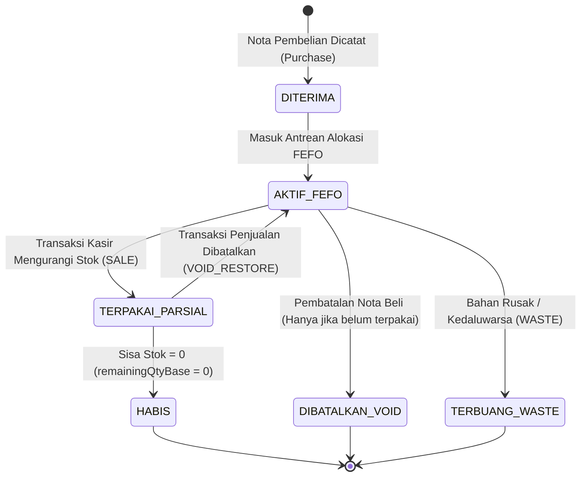
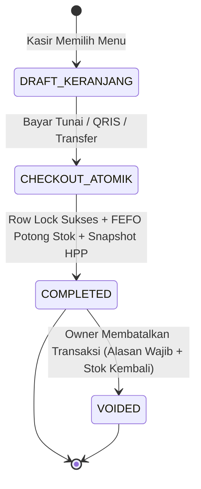
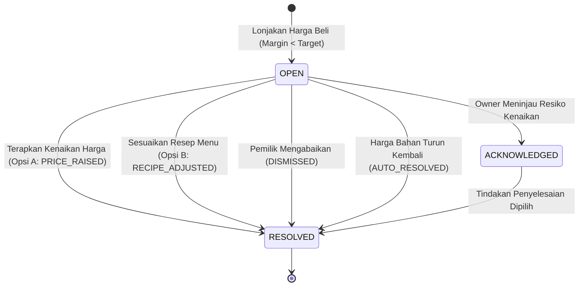

# Entity-Relationship Diagram (ERD) — TakarLaba

> **TakarLaba** — Asisten Penjaga Margin & Anti-Waste untuk UMKM Kuliner.  
> Basis Data: **PostgreSQL 17** (Neon Serverless Postgres) dipetakan via **Prisma ORM 7**.

Dokumen ini mendefinisikan arsitektur data relasional, pemetaan entitas, integritas referensial, indeks performa, serta aturan presisi numerik sistem TakarLaba.

---

## 1. Diagram Relasi Entitas (Mermaid ERD)

```mermaid
erDiagram
    BUSINESS ||--o{ USER : "memiliki"
    BUSINESS ||--o{ INGREDIENT : "memiliki"
    BUSINESS ||--o{ PURCHASE : "mencatat"
    BUSINESS ||--o{ STOCK_BATCH : "mengelola"
    BUSINESS ||--o{ STOCK_MOVEMENT : "merekam"
    BUSINESS ||--o{ MENU : "menyajikan"
    BUSINESS ||--o{ OVERHEAD_COST : "menetapkan"
    BUSINESS ||--o{ SALE : "membukukan"
    BUSINESS ||--o{ MARGIN_ALERT : "mendeteksi"

    USER ||--o{ SESSION : "memiliki sesi"
    USER ||--o{ ACCOUNT : "memiliki akun auth"
    USER ||--o{ PURCHASE : "membuat pembelian"
    USER ||--o{ STOCK_MOVEMENT : "mencatat pergerakan"
    USER ||--o{ MENU_PRICE_HISTORY : "mengubah harga menu"
    USER ||--o{ SALE : "melayani kasir (cashier)"
    USER ||--o{ SALE : "membatalkan penjualan (voidedBy)"
    USER ||--o{ MARGIN_ALERT : "menyelesaikan alert"

    INGREDIENT ||--o{ INGREDIENT_UNIT : "konversi satuan"
    INGREDIENT ||--o{ STOCK_BATCH : "stok batch"
    INGREDIENT ||--o{ STOCK_MOVEMENT : "mutasi stok"
    INGREDIENT ||--o{ RECIPE_ITEM : "komponen resep"
    INGREDIENT ||--o{ MARGIN_ALERT : "pemicu alert kenaikan"

    PURCHASE ||--o{ STOCK_BATCH : "menghasilkan batch"
    PURCHASE ||--o{ MARGIN_ALERT : "pemicu alert nota belanja"

    STOCK_BATCH ||--o{ STOCK_MOVEMENT : "pergerakan batch"

    MENU ||--o{ RECIPE_ITEM : "rincian resep"
    MENU ||--o{ MENU_PRICE_HISTORY : "riwayat perubahan harga"
    MENU ||--o{ SALE_ITEM : "item transaksi penjualan"
    MENU ||--o{ MARGIN_ALERT : "peringatan margin terancam"

    SALE ||--o{ SALE_ITEM : "baris item kasir"

    MARGIN_ALERT ||--o{ MENU_PRICE_HISTORY : "penyesuaian harga rekomendasi"

    BUSINESS {
        string id PK "cuid"
        string name
        boolean isDemo "default false"
        decimal targetMarginDefault "Decimal(5,2) 50.00"
        int expiryWarnDays "default 3"
        int priceRoundingStep "default 500"
        int expectedMonthlyPortions "default 1000"
        decimal wastePromoMinMargin "Decimal(5,2) 10.00"
        string timezone "default Asia/Jakarta"
        datetime demoResetAt "nullable"
        datetime createdAt
    }

    USER {
        string id PK "cuid"
        string name
        string email UK
        boolean emailVerified "default false"
        string image "nullable"
        string role "OWNER | CASHIER"
        string businessId FK "nullable"
        boolean isActive "default true"
        datetime createdAt
        datetime updatedAt
    }

    INGREDIENT {
        string id PK "cuid"
        string businessId FK
        string name
        string nameKey "slug unik per bisnis"
        string category "MAIN | SUPPORT | PACKAGING"
        string baseUnit "G | ML | PCS"
        decimal yieldPercent "Decimal(5,2) default 100.00"
        boolean isPerishable "default false"
        decimal minStockBase "Decimal(14,3) default 0"
        boolean isActive "default true"
        datetime createdAt
        datetime updatedAt
    }

    INGREDIENT_UNIT {
        string id PK "cuid"
        string ingredientId FK
        string name "kg, liter, pack, botol"
        decimal toBaseFactor "Decimal(14,4) pengali ke base unit"
        datetime createdAt
    }

    PURCHASE {
        string id PK "cuid"
        string businessId FK
        string supplierName "nullable"
        datetime purchasedAt
        string note "nullable ([DIBATALKAN: ...] jika di-void)"
        decimal totalAmount "Decimal(14,2) total belanja Rp"
        string createdById FK
        datetime createdAt
    }

    STOCK_BATCH {
        string id PK "cuid"
        string businessId FK
        string ingredientId FK
        string purchaseId FK "nullable"
        datetime receivedAt
        datetime expiryDate "nullable"
        decimal purchaseQty "Decimal(14,3)"
        string purchaseUnit
        decimal purchaseUnitPrice "Decimal(14,2)"
        decimal initialQtyBase "Decimal(14,3)"
        decimal remainingQtyBase "Decimal(14,3)"
        decimal costPerBase "Decimal(18,6) HPP per raw base unit"
        datetime createdAt
    }

    STOCK_MOVEMENT {
        string id PK "cuid"
        string businessId FK
        string ingredientId FK
        string batchId FK "nullable"
        string type "PURCHASE | SALE | VOID_RESTORE | WASTE | ADJUSTMENT"
        decimal qtyBaseDelta "Decimal(14,3) (+ / -)"
        decimal costPerBase "Decimal(18,6)"
        string refType "nullable (PURCHASE, SALE, WASTE, etc.)"
        string refId "nullable"
        string note "nullable"
        string createdById FK "nullable"
        datetime createdAt
    }

    MENU {
        string id PK "cuid"
        string businessId FK
        string name
        string nameKey "slug unik per bisnis"
        string category "nullable"
        decimal sellingPrice "Decimal(14,2)"
        decimal targetMargin "Decimal(5,2) nullable override"
        boolean isActive "default true"
        datetime createdAt
        datetime updatedAt
    }

    RECIPE_ITEM {
        string id PK "cuid"
        string menuId FK
        string ingredientId FK
        decimal qtyUsableBase "Decimal(14,3) takaran bersih per porsi"
        datetime createdAt
    }

    OVERHEAD_COST {
        string id PK "cuid"
        string businessId FK
        string name "Listrik, Sewa, Gaji Barista"
        string type "UTILITY | LABOR | DEPRECIATION | OTHER"
        decimal monthlyAmount "Decimal(14,2)"
        boolean isActive "default true"
        datetime createdAt
        datetime updatedAt
    }

    MENU_PRICE_HISTORY {
        string id PK "cuid"
        string menuId FK
        decimal oldPrice "Decimal(14,2)"
        decimal newPrice "Decimal(14,2)"
        string reason "MANUAL | PRICE_SHOCK_ALERT"
        string alertId FK "nullable"
        string changedById FK
        datetime changedAt
    }

    SALE {
        string id PK "cuid"
        string businessId FK
        string invoiceNo "INV-YYYYMMDD-XXXX"
        string idempotencyKey "UUID idempotency kasir"
        datetime soldAt
        string cashierId FK
        string paymentMethod "CASH | QRIS | TRANSFER"
        decimal totalAmount "Decimal(14,2)"
        decimal totalIngredientCost "Decimal(14,2) HPP Aktual"
        decimal totalOverhead "Decimal(14,2) Alokasi overhead"
        string status "COMPLETED | VOIDED"
        datetime voidedAt "nullable"
        string voidReason "nullable"
        string voidedById FK "nullable"
        datetime createdAt
    }

    SALE_ITEM {
        string id PK "cuid"
        string saleId FK
        string menuId FK
        string menuNameSnapshot
        int qty
        decimal unitPrice "Decimal(14,2)"
        decimal ingredientCostActual "Decimal(14,2)"
        decimal overheadAllocated "Decimal(14,2)"
    }

    MARGIN_ALERT {
        string id PK "cuid"
        string businessId FK
        string menuId FK
        string status "OPEN | ACKNOWLEDGED | RESOLVED"
        string resolution "PRICE_RAISED | RECIPE_ADJUSTED | DISMISSED | AUTO_RESOLVED"
        string triggerPurchaseId FK "nullable"
        string triggerIngredientId FK "nullable"
        decimal ingredientCostBefore "Decimal(18,6)"
        decimal ingredientCostAfter "Decimal(18,6)"
        decimal fullCostBefore "Decimal(14,2)"
        decimal fullCostAfter "Decimal(14,2)"
        decimal marginBeforePct "Decimal(5,2)"
        decimal marginAfterPct "Decimal(5,2)"
        decimal targetPct "Decimal(5,2)"
        decimal sellingPriceAtTrigger "Decimal(14,2)"
        decimal recommendedPrice "Decimal(14,2)"
        datetime createdAt
        datetime updatedAt
        datetime resolvedAt "nullable"
        string resolvedById FK "nullable"
        string note "nullable"
    }
```

---

## 2. Prinsip Arsitektur Data

### 2.1 Multi-Tenant Isolation (Pemisahan Tenant Bisnis)
- **Root Tenant:** Tabel `Business` menjadi jangkar kepemilikan data. Setiap data operasional (`User`, `Ingredient`, `Purchase`, `StockBatch`, `StockMovement`, `Menu`, `OverheadCost`, `Sale`, `MarginAlert`) memiliki kolom foreign key wajib `businessId` (kecuali session & account autentikasi Better Auth yang terikat langsung ke `User`).
- **Otoritatif di Backend:** Backend menginjeksi `businessId` dari konteks sesi terverifikasi (`req.ctx.businessId`). Klien **tidak diperbolehkan** mengirimkan atau memanipulasi `businessId` via URL query atau body payload (Rule 5 & 6).
- **Composite Unique Keys:**
  - `[businessId, nameKey]` pada `Ingredient` dan `Menu` memastikan keunikan nama bahan dan menu dalam satu tenant tanpa bentrok antar bisnis.
  - `[businessId, invoiceNo]` dan `[businessId, idempotencyKey]` pada `Sale` menjamin nomor faktur dan idempoten tidak tumpang tindih.

### 2.2 Presisi Numerik & Matematika Uang (Anti-Float Policy)
Sesuai prinsip keandalan kalkulasi finansial, sistem melarang tipe bilangan mengambang (`float`/`double`) untuk mencegah error akumulasi pembulatan (mis. `0.1 + 0.2 = 0.30000000000000004`):

| Domain | Tipe Database (PostgreSQL) | Tipe Runtime Backend | Format JSON / API DTO | Contoh Nilai |
| :--- | :--- | :--- | :--- | :--- |
| **Harga Pokok / Base Cost** | `Decimal(18, 6)` | `decimal.js` | String (6 desimal) | `"18.525000"` (Rp/g) |
| **Nilai Uang / Rupiah (IDR)** | `Decimal(14, 2)` | `decimal.js` | String (2 desimal) | `"18000.00"`, `"150000.00"` |
| **Kuantitas Stok (Base Unit)** | `Decimal(14, 3)` | `decimal.js` | String (3 desimal) | `"1500.000"` (g/ml), `"10.000"` (pcs) |
| **Persentase Margin & Yield** | `Decimal(5, 2)` | `decimal.js` | String (1-2 desimal) | `"50.00"`, `"45.3"`, `"85.00"` |
| **Faktor Pengali Satuan** | `Decimal(14, 4)` | `decimal.js` | String (4 desimal) | `"1000.0000"` (1 kg = 1000 g) |

---

## 3. Kamus Data & Spesifikasi Entitas

### 3.1 `Business` (Model: `business`)
Mewakili satu entitas usaha kuliner (tenant).
- **`id`** (`String`, PK, default CUID): Identifikasi unik tenant.
- **`name`** (`String`): Nama komersial usaha (mis. "Kopi Takar Laba").
- **`isDemo`** (`Boolean`, default `false`): Menandai akun contoh demo untuk juri kompetisi GTNIC 2026.
- **`targetMarginDefault`** (`Decimal(5,2)`, default `50.00`): Sasaran margin kotor standar usaha (%).
- **`expiryWarnDays`** (`Int`, default `3`): Jendela ambang batas peringatan dini kedaluwarsa bahan baku (hari).
- **`priceRoundingStep`** (`Int`, default `500`): Langkah pembulatan ke atas (*ceiling step*) rekomendasi harga jual (Rp).
- **`expectedMonthlyPortions`** (`Int`, default `1000`): Estimasi volume porsi terjual per bulan sebagai penyebut alokasi overhead per porsi (BR-01).
- **`wastePromoMinMargin`** (`Decimal(5,2)`, default `10.00`): Batas aman margin lantai untuk strategi obral anti-waste bahan mendekati kedaluwarsa (%).
- **`timezone`** (`String`, default `"Asia/Jakarta"`): Zona waktu operasional (WIB/UTC+7).
- **`demoResetAt`** (`DateTime`, nullable): Timestamp pencatatan reset data demo terakhir.

---

### 3.2 `User` (Model: `user`)
Data pengguna sistem (Owner atau Kasir) yang terintegrasi dengan Better Auth.
- **`role`** (`String`, default `"OWNER"`): Hak akses (`OWNER` atau `CASHIER`).
- **`businessId`** (`String`, FK ke `Business.id`, `ON DELETE CASCADE`): Relasi bisnis induk.
- **`isActive`** (`Boolean`, default `true`): Status aktif pengguna.
- **Relasi:**
  - `sessions`: Token sesi login aktif via HTTP-only cookie.
  - `cashierSales`: Daftar transaksi yang diproses sebagai kasir.
  - `voidedSales`: Daftar transaksi kasir yang dibatalkan oleh pengguna.

---

### 3.3 `Ingredient` & `IngredientUnit` (Model: `ingredient`, `ingredient_unit`)
Master bahan baku dapur dan pemetaan multi-satuan pembelian ke raw base unit.
- **Raw Base Units:** Hanya 3 satuan dasar standar internasional kuliner:
  - `G` (Gram) untuk bahan padat/bubuk (biji kopi, tepung, gula pasir).
  - `ML` (Mililiter) untuk bahan cair (susu cair, sirup, kental manis).
  - `PCS` (Pieces) untuk satuan satuan/kemasan (cup 16oz, sedotan, lid, telur).
- **`yieldPercent`** (`Decimal(5,2)`, default `100.00`): Persentase rendemen bahan setelah proses *trimming*/pembersihan (BR-02).
- **`isPerishable`** (`Boolean`, default `false`): Menandai bahan segar berumur simpan pendek yang memerlukan tanggal kedaluwarsa wajib pada setiap nota pembelian.
- **`toBaseFactor`** pada `IngredientUnit`: Nilai konversi ke base unit (misal 1 KG = 1.000 G, 1 Liter = 1.000 ML, 1 Rim = 500 PCS).

---

### 3.4 `Purchase` & `StockBatch` (Model: `purchase`, `stock_batch`)
Penerimaan belanja bahan baku dan pencatatan inventaris berbasis batch FEFO.
- **`StockBatch`:**
  - Setiap pembelian bahan baku memecah penerimaan menjadi record batch terpisah.
  - **`expiryDate`** (`DateTime`, nullable): Tanggal kedaluwarsa batch. Batch dengan tanggal kedaluwarsa terdekat akan dikonsumsi pertama kali oleh kasir (**FEFO**). Bahan non-perishable (`expiryDate = null`) diprioritaskan setelah bahan perishable dan dikonsumsi berdasarkan `receivedAt ASC` (**FIFO fallback**).
  - **`costPerBase`** (`Decimal(18,6)`): Nilai modal bahan per satuan dasar dihitung dari:
    $$\text{costPerBase} = \frac{\text{purchaseUnitPrice}}{\text{purchaseQty} \times \text{toBaseFactor}}$$
- **Pembatalan Nota (`Purchase Void`):**
  - Dilakukan secara atomik jika seluruh batch dari nota terkait belum terpakai (`remainingQtyBase === initialQtyBase`).
  - Nota ditandai dengan prefix catatan `[DIBATALKAN: <alasan>]`, sisa stok batch dikosongkan menjadi 0, dan pergerakan stok pembalik `StockMovement(ADJUSTMENT)` dicatat.

---

### 3.5 `StockMovement` (Model: `stock_movement`)
Buku besar mutasi persediaan (audit trail pergerakan stok tanpa modifikasi langsung).
- **`type`** (`MovementType`):
  - `PURCHASE`: Penambahan stok dari penerimaan belanja baru (+).
  - `SALE`: Pengurangan stok bahan baku akibat transaksi kasir (-).
  - `VOID_RESTORE`: Pengembalian stok kembali ke batch asal saat transaksi penjualan kasir di-void (+).
  - `WASTE`: Pemotongan bahan kedaluwarsa / rusak / tumpah (-).
  - `ADJUSTMENT`: Penyesuaian stok opname atau pembatalan nota pembelian (-/+).
- **`refType` & `refId`**: Tautan referensi transaksi sumber (`PURCHASE`, `SALE`, `PURCHASE_VOID`, `WASTE_RECORD`).

---

### 3.6 `Menu` & `RecipeItem` (Model: `menu`, `recipe_item`)
Katalog menu siap saji dan formulasi takaran resep bahan baku bersih (*usable base quantity*).
- **`RecipeItem.qtyUsableBase`** (`Decimal(14,3)`): Takaran bersih bahan per porsi.
- **Kalkulasi Kebutuhan Bahan Baku Mentah:**
  $$\text{rawBaseNeeded} = \frac{\text{qtyUsableBase}}{\text{yieldPercent} / 100}$$
- **HPP Bahan Pokok (Menu Costing):**
  - **HPP Aktual:** Dihitung dari biaya riil batch yang sedang aktif dialokasikan oleh urutan FEFO.
  - **HPP Pengganti (*Replacement Cost*):** Dihitung dari `costPerBase` batch pembelian paling akhir yang tercatat di database (BR-04).
- **HPP Penuh (*Full Costing*):**
  $$\text{HPP Penuh} = \text{HPP Bahan Baku} + \text{Alokasi Beban Overhead per Porsi}$$

---

### 3.7 `OverheadCost` & `MenuPriceHistory` (Model: `overhead_cost`, `menu_price_history`)
Biaya operasional bulanan tetap dan jejak riwayat perubahan harga jual.
- **`OverheadCost`:** Mencatat biaya rutin seperti sewa tempat, tagihan listrik/air/WiFi, gaji staf, depresiasi mesin kopi, dan biaya operasional lain.
- **Alokasi Overhead per Porsi (BR-01):**
  $$\text{overheadPerPortion} = \frac{\sum \text{monthlyAmount}}{\text{expectedMonthlyPortions}}$$
- **`MenuPriceHistory`:** Mencatat kronologi kenaikan/penurunan harga jual menu, harga lama vs baru, tanggal pengubahan, user pengubah, dan referensi ke `MarginAlert` jika dipicu oleh respons *Price Shock*.

---

### 3.8 `Sale` & `SaleItem` (Model: `sale`, `sale_item`)
Pencatatan transaksi penjualan kasir (Point of Sale) secara atomik.
- **`idempotencyKey`**: Menjamin tidak terjadi transaksi ganda akibat duplikasi klik atau koneksi tidak stabil.
- **Row Locking (`SELECT ... FOR UPDATE`):** Pemotongan batch persediaan dieksekusi dengan kuncian baris database untuk mencegah *race condition* stok minus saat penjualan bersamaan.
- **Financial Snapshots:**
  - `totalIngredientCost`: Biaya bahan pokok riil pada saat transaksi dibuat (HPP Aktual).
  - `totalOverhead`: Porsi overhead yang dibebankan pada transaksi tersebut.
  - Snapshot ini menjaga laporan laba kotor historis tetap akurat meskipun harga bahan baku di masa depan mengalami kenaikan.
- **`status`** (`SaleStatus`):
  - `COMPLETED`: Transaksi sukses dan membukukan pendapatan.
  - `VOIDED`: Transaksi dibatalkan (FR-POS-03). Mengembalikan stok porsi menu kembali ke batch asal secara proporsional.

---

### 3.9 `MarginAlert` (Model: `margin_alert`)
Sistem peringatan otomatis saat lonjakan harga bahan baku (*Price Shock*) mengikis margin keuntungan menu di bawah target bisnis (BR-05, BR-06).
- **Kondisi Pemicu:**
  Dihitung seketika saat pembelian baru (`Purchase`) dicatat. Jika $\text{marginAfterPct} < \text{targetPct}$, sistem menerbitkan alert berstatus `OPEN`.
- **Rekomendasi Cerdas (Dua Pilihan Solusi):**
  - **Opsi A (Naikkan Harga Jual):** Merekomendasikan harga baru yang dibulatkan ke atas sesuai kelipatan `priceRoundingStep` (misal Rp500) agar margin kembali $\ge \text{targetPct}$.
  - **Opsi B (Efisiensi Takaran Bahan Baku):** Menghitung pengurangan kuantitas bahan pemicu agar margin pulih tanpa menaikkan harga jual kepada pelanggan (batas kelayakan minimal 50% resep asli).
- **Auto-Resolve (D-06):** Jika pembelian bahan berikutnya terjadi di harga lebih murah sehingga margin kembali normal, alert otomatis berubah menjadi `RESOLVED` dengan resolusi `AUTO_RESOLVED`.

---

## 4. Diagram Siklus Hidup Entitas Kunci

### 4.1 Siklus Hidup Batch Stok (`StockBatch`)

---

### 4.2 Siklus Hidup Transaksi Penjualan (`Sale`)

---

### 4.3 Siklus Hidup Peringatan Margin (`MarginAlert`)

---

## 5. Ringkasan Integritas Referensial & Indeks

| Relasi Parent $\rightarrow$ Child | Aksi `ON DELETE` | Alasan Bisnis & Desain Keamanan |
| :--- | :--- | :--- |
| `Business` $\rightarrow$ `*` (All Domain Data) | `CASCADE` | Isolasi tenant: penghapusan akun bisnis membersihkan seluruh data terkait secara tuntas. |
| `User` $\rightarrow$ `Purchase` | `RESTRICT` | Audit kepatuhan finansial: dilarang menghapus akun user yang telah menandatangani nota belanja. |
| `User` $\rightarrow$ `Sale (cashier)` | `RESTRICT` | Integritas kasir: transaksi penjualan tidak boleh kehilangan catatan kasir yang melayani. |
| `Ingredient` $\rightarrow$ `StockBatch` | `RESTRICT` | Master bahan dilarang dihapus jika masih memiliki riwayat batch fisik di gudang. |
| `Ingredient` $\rightarrow$ `RecipeItem` | `RESTRICT` | Bahan baku tidak boleh dihapus jika masih menjadi formula resep aktif suatu menu. |
| `Menu` $\rightarrow$ `SaleItem` | `RESTRICT` | Rekam jejak penjualan historis tidak boleh rusak jika suatu menu dihapus/dinonaktifkan. |
| `Purchase` $\rightarrow$ `StockBatch` | `SET NULL` | Memungkinkan audit batch independen jika header nota diperbaiki/dibersihkan. |

### Indeks Performa Kritis
1. **`StockBatch(businessId, expiryDate)`**: Mempercepat alokasi algoritma FEFO dan deteksi dini bahan kedaluwarsa.
2. **`StockMovement(businessId, createdAt)`**: Optimal untuk pelaporan kartu stok dan histori mutasi harian.
3. **`Sale(businessId, soldAt)`**: Mempercepat agregasi grafik tren penjualan 7 hari, 30 hari, serta laporan omzet per tanggal.
4. **`MarginAlert(businessId, status)`**: Memastikan query banner peringatan darurat margin berjalan sub-5 milidetik.
