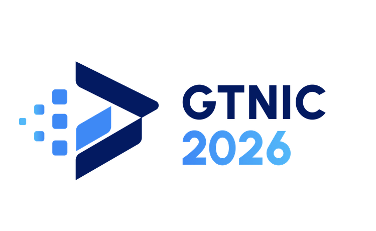

# PROPOSAL KARYA (UX CASE STUDY)
# GARDA TECH NATIONAL INNOVATION COMPETITION (GTNIC) 2026

**KATEGORI:** Web Development  
**Sub-Tema:** "Accelerating Digital Transformation for Business and SMEs"  
**JUDUL KARYA / APLIKASI WEB:** TakarLaba: Asisten Penjaga Margin & Anti-Waste untuk UMKM Kuliner Berbasis Multi-Tenant Decision Layer  

---

<!-- ============================================================
     HALAMAN SAMPUL / COVER
     Logo GTNIC 2026 tersedia pada berkas: docs/gtnic-logo.png
     ============================================================ -->



**Disusun Oleh Tim:** [NAMA TIM]
1. [Nama Ketua Tim] - [Asal sekolah/Kampus] (Ketua / Fullstack Architect)
2. [Nama Anggota 1] - [Asal sekolah/Kampus] (Frontend Developer / UI-UX Designer)
3. [Nama Anggota 2] - [Asal sekolah/Kampus] (Backend & Database Engineer)

---

## 1. LATAR BELAKANG MASALAH

Berdasarkan data Kementerian Koperasi dan UKM serta Badan Pusat Statistik (Sakernas Agustus 2025), Indonesia memiliki antara 56 hingga 65 juta unit Usaha Mikro, Kecil, dan Menengah (UMKM), di mana 96,8% di antaranya merupakan usaha berskala mikro. Sektor makanan dan minuman (*Food and Beverage* / F&B) merupakan penyerap tenaga kerja terbesar dan penggerak utama ekonomi kerakyatan dengan perputaran permodalan harian yang sangat cepat.

Meskipun menyumbang kontribusi ekonomi yang signifikan, mayoritas pelaku UMKM kuliner di Indonesia menghadapi risiko kegagalan operasional yang tinggi. Observasi lapangan dan studi empiris akuntansi biaya UMKM menunjukkan bahwa akar masalah utama terletak pada ketiadaan sistem pendukung keputusan (*decision-support system*) yang andal dalam menjaga margin laba dan mengendalikan persediaan bahan baku:

1. **Perhitungan HPP Statis & Terjebak Margin Semu (*Illusionary Margin*):**  
   Pelaku UMKM kuliner umumnya hanya menghitung Harga Pokok Penjualan (HPP) satu kali saat pertama kali meluncurkan produk. Ketika terjadi kenaikan harga bahan baku mentah di pasar tradisional (seperti telur, minyak goreng, cabai, gula, atau susu), pengusaha tidak pernah memperbarui HPP resep mereka. Akibatnya, timbul fenomena *margin semu*—kedai terlihat ramai dan omzet penjualan tampak tinggi, namun uang kas operasional di akhir bulan selalu tekor karena margin keuntungan telah tergerus inflasi bahan tanpa disadari.

2. **Pengabaian Beban Biaya Overhead & Bahan Penolong (*Cost Distortion*):**  
   Pencatatan konvensional UMKM hampir selalu hanya menghitung bahan baku utama dan mengabaikan beban utilitas harian (listrik, gas elpiji, air galon), biaya penyusutan peralatan dapur, upah tenaga kerja per porsi, serta kemasan penolong (kantong kresek, sedotan, cup lid, stiker). Studi empiris *recipe-based full costing* (Universitas Tanjungpura) mencatat bahwa pencatatan biaya konvensional menghasilkan HPP terdistorsi terlalu rendah antara **20% hingga 35%**, menciptakan ilusi keuntungan palsu.

3. **Limbah Stok Tanpa Manajemen FEFO (*First Expired, First Out*):**  
   Bahan baku makanan dan minuman memiliki karakteristik mudah rusak (*perishable*) dengan masa kedaluwarsa yang ketat. Tanpa alokasi persediaan berbasis tanggal kedaluwarsa, bahan baku yang dibeli lebih awal sering tertimbun di belakang rak penyimpanan dan membusuk (*food waste*). Hal ini memicu kerugian langsung yang menggerus modal kerja usaha mikro.

4. **Ilusi Menu Terlaris (*Popularity Trap*):**  
   Banyak pemilik usaha mencurahkan tenaga dan biaya promosi pada menu yang paling banyak terjual, tanpa menyadari bahwa menu tersebut memiliki margin kontribusi rupiah yang sangat tipis. Keputusan bisnis kerap diambil atas dasar intuisi dan perasaan (*gut feeling*), bukan berbasis analitik profitabilitas objektif.

5. **Kesenjangan Solusi Kasir (POS) di Pasaran:**  
   Solusi kasir digital (*Point of Sale*) yang beredar saat ini umumnya hanya berfungsi sebagai pencatat transaksi kasir (*system of record*). Fitur penghitungan resep Bill of Materials (BOM) sering kali dikunci di paket langganan enterprise yang mahal (Rp150.000–Rp500.000/gerai/bulan), tanpa menyediakan lapisan intelijen (*decision layer*) yang mampu mensimulasikan solusi taktis seketika saat terjadi lonjakan harga bahan baku.

---

## 2. TUJUAN, MANFAAT, DAN SOLUSI

### 2.1 Tujuan
1. **Mengembangkan Sistem Otomasi Costing Dinamis:** Merancang platform web yang menghitung HPP Bahan (*raw cost*), HPP Penuh (*full costing* dengan penyerapan overhead per porsi), HPP Pengganti (*replacement cost*), dan HPP Aktual (*historical batch cost*) secara real-time.
2. **Membangun Mesin Deteksi & Mitigasi Price Shock:** Menyediakan deteksi instan anjloknya margin akibat kenaikan harga beli bahan baku beserta simulasi taktis: penyesuaian harga jual baru psikologis (Opsi A) dan rekayasa porsi takaran bahan (Opsi B).
3. **Mewujudkan Pengelolaan Stok Anti-Waste Berbasis FEFO:** Mengotomatisasikan pemotongan batch stok kedaluwarsa paling awal secara atomik melalui transaksi *database row-level locking*, dilengkapi mekanisme pemulihan stok (*void restore*).
4. **Menyajikan Analitik Profitabilitas Menu Ilmiah:** Mengimplementasikan matriks *Menu Engineering* 4 kuadran Kasavana & Smith (*Star, Plowhorse, Puzzle, Dog*) untuk memandu strategi penetapan harga dan promosi menu.
5. **Menerapkan Perlindungan Kerahasiaan Finansial Kasir:** Memisahkan hak akses pemilik (*Owner*) dan staf kasir (*Cashier*) dengan pembersihan data biaya (*Cashier Privacy Shield*) di lapisan backend.

### 2.2 Manfaat
- **Bagi Pemilik Usaha (Owner):**
  - Memperoleh visibilitas margin laba riil per menu dalam hitungan detik tanpa membuka buku catatan atau rumus spreadsheet rumit.
  - Memperoleh rekomendasi taktis instan saat harga pasar naik sehingga tidak terlambat merespons inflasi.
  - Mengeliminasi risiko kerugian finansial akibat bahan kedaluwarsa melalui panel deteksi risiko dini (*Waste Radar*).
  - Melindungi kerahasiaan margin keuntungan dan harga kulakan bahan dari jangkauan staf kasir.
- **Bagi Kasir & Staf Operasional:**
  - Mengoperasikan kasir POS dengan cepat dan intuitif melalui tampilan *mobile-first* yang optimal pada layar sentuh ponsel (360 px).
  - Mengetahui sisa kapasitas porsi menu yang dapat dibuat secara instan beserta bahan baku yang menjadi penghambat utama (*bottleneck*), mencegah pesanan ditolak setelah transaksi dibayar.
  - Mempercepat proses cetak struk nota belanja thermal langsung dari browser peramban.
- **Bagi Industri UMKM & Lingkungan:**
  - Membantu menurunkan angka kegagalan usaha mikro kuliner nasional melalui digitalisasi pembukuan finansial yang presisi.
  - Mendukung inisiatif keberlanjutan lingkungan dengan mengurangi limbah makanan (*food waste*) melalui alokasi FEFO dan pemanfaatan promo bahan menjelang kedaluwarsa.

### 2.3 Solusi Teknologi yang Ditawarkan
TakarLaba hadir bukan sekadar sebagai aplikasi kasir (*system of record*), melainkan sebagai **Asisten Penjaga Margin & Anti-Waste berbasis *Multi-Tenant Decision Layer***. 

Sistem ini menggabungkan:
1. **Mesin Costing Multi-Metode Murni:** Menghitung konversi satuan otomatis (misal kg ke gram, Liter ke mililiter), faktor *yield* bahan usable, dan pembagian beban utilitas bulanan ke tiap porsi resep secara presisi desimal tanpa pembulatan *floating-point*.
2. **Price Shock Mitigation Engine (BR-05, BR-06):** Ketika nota pembelian baru dicatat dan harga beli melonjak, sistem seketika memunculkan modal mitigasi:
   - **Opsi A (Naikkan Harga Jual):** Rekomendasi harga baru dengan pembulatan ke atas (*ceiling*) kelipatan langkah psikologis UMKM (misal kelipatan Rp500).
   - **Opsi B (Rekayasa Takaran Porsi):** Menghitung pengurangan gramatur takaran bahan yang naik agar harga jual tetap stabil, dengan ambang batas penurunan maksimal 50% untuk menjaga cita rasa.
3. **Atomic FEFO Stock Engine (BR-07):** Algoritma pemotongan stok otomatis yang mengonsumsi batch dengan tanggal kedaluwarsa paling awal menggunakan transaksi terkunci `SELECT ... FOR UPDATE`, mencegah *race condition* stok negatif saat kasir bertransaksi simultan.
4. **Matriks Menu Engineering 4 Kuadran (BR-08, BR-10):** Memetakan menu selama 30 hari ke dalam kuadran *Star, Plowhorse, Puzzle,* dan *Dog* menggunakan margin kontribusi rupiah dan ambang popularitas Kasavana & Smith, dilengkapi rekomendasi taktis otomatis.

---

## 3. TARGET PENGGUNA / PASAR APLIKASI

### 3.1 Karakteristik Target Pasar
Target pasar TakarLaba difokuskan pada pelaku UMKM kuliner di Indonesia dengan karakteristik:
- **Skala Usaha:** Usaha mikro dan kecil mandiri (1–3 gerai) dengan omzet bulanan antara Rp5 juta hingga Rp50 juta.
- **Jenis Industri:** Kedai kopi (*coffee shop*), kedai teh kekinian, bakery & pastry, warung makan, kuliner *cloud kitchen*, katering harian, dan usaha makanan beku (*frozen food*).
- **Infrastruktur Perangkat:** Menggunakan perangkat yang sudah dimiliki (ponsel cerdas Android/iOS, tablet, atau laptop standar) tanpa kewajiban membeli perangkat kasir POS berbayar yang mahal.
- **Kondisi Literasi:** Memerlukan antarmuka berbahasa Indonesia yang sederhana, visual, bebas dari istilah jargon akuntansi rumit, dan dapat dioperasikan dalam hitungan menit tanpa pelatihan teknis khusus.

### 3.2 User Persona

#### Persona 1: Pemilik Usaha (Owner)
- **Nama:** Budi Santoso (38 tahun)
- **Peran:** Pemilik Kedai Kopi "Kopi Sahabat" (1 gerai, 12 varian minuman, omzet Rp18 juta/bulan).
- **Tantangan / Pain Points:**
  - Sering terkejut saat membeli susu UHT dan sirup yang harganya naik di toko grosir, namun bingung harus menaikkan harga jual berapa agar pelanggan tidak lari.
  - Sering menemukan stok susu dan krimer kedaluwarsa di pojok gudang, rugi ratusan ribu rupiah tiap bulan.
  - Menganggap menu yang paling laku otomatis paling menguntungkan, padahal margin labanya sangat tipis setelah dipotong biaya gelas plastik dan sedotan.
- **Mengapa TakarLaba Relevan:**  
  TakarLaba memberikan notifikasi *Price Shock* saat ia mencatat belanja susu, menghitungkan rekomendasi harga baru atau saran pengurangan takaran dalam 10 detik, serta menampilkan visual kuadran menu terlaris vs menu paling menguntungkan.

#### Persona 2: Kasir & Staf Operasional (Cashier)
- **Nama:** Siti Rahmawati (21 tahun)
- **Peran:** Kasir & Barista paruh waktu.
- **Tantangan / Pain Points:**
  - Menggunakan ponsel pribadi di meja kasir yang sempit; aplikasi kasir konvensional sering memiliki tombol kecil dan berbelit-belit.
  - Pernah menerima pesanan dan pembayaran dari pelanggan, tetapi saat dibuat di bar ternyata sirup gula arennya sudah habis, memicu komplain pembeli.
- **Mengapa TakarLaba Relevan:**  
  Antarmuka POS TakarLaba dirancang *mobile-first* (nyaman di layar 360 px), dilengkapi tombol angka cepat, pencarian instan, dan indikator kapasitas sisa porsi yang memberi peringatan bahan mana yang habis sebelum transaksi dibayar. Data rahasia harga kulakan dan margin laba pemilik juga terlindungi dari pandangannya.

---

## 4. FITUR UTAMA & KEUNIKAN APLIKASI

### 4.1 Fitur Utama

| No | Fitur | Deskripsi Fungsional | Hak Akses Owner | Hak Akses Kasir |
|:---:|---|---|:---:|:---:|
| 1 | **Dashboard Usaha & KPI** | Menampilkan omzet riil, estimasi laba kotor, grafik tren penjualan 7 hari, ranking menu terlaris, ringkasan margin terancam, dan stok kritis. | ✅ Lengkap | ❌ Dibatasi |
| 2 | **Pusat Peringatan (Price Shock Alerts)** | Mendeteksi penurunan margin menu di bawah target bisnis pasca-pembelian bahan, menyajikan simulasi Opsi A (naikkan harga) dan Opsi B (rekayasa porsi), serta aksi terapkan instan. | ✅ Penuh | ❌ Tidak Ada |
| 3 | **Manajemen Bahan & Konversi Satuan** | Pengelolaan master bahan baku, satuan beli vs satuan dasar (kg $\rightarrow$ g, L $\rightarrow$ ml, lusin $\rightarrow$ pcs), konversi faktor *yield* bahan olahan, dan ambang batas stok minimum. | ✅ Penuh | ❌ Tidak Ada |
| 4 | **Editor Resep & Live Costing Preview** | Penyusunan Bill of Materials (BOM) resep menu dengan pratinjau kalkulasi seketika (debounced 300 ms) untuk HPP Bahan, HPP Penuh, HPP Aktual, dan HPP Pengganti. | ✅ Penuh | ❌ Tidak Ada |
| 5 | **Pengaturan Usaha & Beban Overhead** | Pengaturan target margin default (mis. 50%), langkah pembulatan harga jual (mis. Rp500), target porsi bulanan, dan pencatatan beban utilitas/sewa/alat per porsi (*full costing*). | ✅ Penuh | ❌ Tidak Ada |
| 6 | **Katalog Menu & Riwayat Harga** | Daftar menu kuliner, riwayat perubahan harga jual, filter kategori, serta badge status margin semantik (Aman / Waspada / Bahaya). | ✅ Penuh | ❌ Tidak Ada |
| 7 | **Kasir POS Mobile-First Cerdas** | Grid katalog menu cepat, keranjang belanja interaktif, kalkulator nominal bayar dan kembalian, pintasan keyboard kasir, proteksi *Idempotency-Key*, dan dialog cetak struk nota belanja thermal CSS. | ✅ Penuh | ✅ Penuh (Tanpa Info Biaya) |
| 8 | **Alokasi Stok FEFO Otomatis Atomik** | Pemotongan stok otomatis dari batch kedaluwarsa paling awal dengan row-level lock (`SELECT ... FOR UPDATE`), mencegah *race condition* stok negatif. | ✅ Sistem | ✅ Sistem |
| 9 | **Kapasitas & Deteksi Bottleneck Porsi** | Perhitungan sisa porsi menu yang dapat dibuat berdasarkan ketersediaan bahan baku real-time, menyorot bahan baku pembatas (*bottleneck ingredient*). | ✅ Lengkap | ✅ Tanpa Data Biaya |
| 10 | **Riwayat Penjualan & Void Restore** | Pencatatan transaksi penjualan, filter tanggal dan metode bayar, modal rincian alokasi batch stok terpotong, serta fitur pembatalan (*Void*) dengan pemulihan stok atomik ke batch asal. | ✅ Lengkap | ✅ Transaksi Sendiri |
| 11 | **Matriks Menu Engineering** | Analisis performa 30 hari dalam 4 kuadran Kasavana & Smith (*Star, Plowhorse, Puzzle, Dog*) berbasis margin kontribusi rupiah, dilengkapi rekomendasi taktis bisnis. | ✅ Penuh | ❌ Tidak Ada |
| 12 | **Waste Radar & Catat Kerugian Limbah** | Deteksi batch bahan mendekati/melewati kedaluwarsa, perhitungan potensi nilai rupiah kerugian limbah, rekomendasi harga lantai promo dan diskon aman, serta formulir pencatatan bahan terbuang (*Waste*). | ✅ Penuh | ❌ Tidak Ada |
| 13 | **Penyesuaian Stok (Stock Opname)** | Pencatatan rekonsiliasi fisik bahan baku di gudang dengan mutasi penyesuaian stok (*ADJUSTMENT*) untuk mengoreksi selisih stok riil. | ✅ Penuh | ❌ Tidak Ada |
| 14 | **Ekspor Laporan Finansial CSV** | Pengunduhan data transaksi penjualan dan status stok gudang berformat CSV standar RFC 4180 dengan proteksi formula injection untuk olah data mandiri. | ✅ Penuh | ❌ Tidak Ada |
| 15 | **Mode Demo Deterministik Juri** | Tombol login sekali klik (Demo Owner dan Demo Kasir) serta fitur reset instan basis data sesuai skenario PRD Lampiran B (16 bahan, 6 menu, 1.300 porsi historis) dengan proteksi jeda 60 detik. | ✅ Penuh | ❌ Dibatasi |

### 4.2 Keunikan / Nilai Inovasi Dibanding Sistem Serupa

| Dimensi Fitur & Strategi | Aplikasi Kasir / POS Konvensional di Pasar (Moka, Pawoon, Olsera, Majoo) | TakarLaba (Asisten Penjaga Margin & Anti-Waste) |
|---|---|---|
| **Paradigma Peran Sistem** | Sekadar mesin pencatat transaksi kasir (*system of record*). | Lapisan intelijen pendukung keputusan operasional (*decision layer / system of intelligence*). |
| **Deteksi Lonjakan Harga Bahan (*Price Shock*)** | Pasif; hanya mencatat riwayat pembelian di pembukuan tanpa analisis dampak ke menu. | Proaktif; seketika menghitung anjloknya margin per menu dan menampilkan modal dampak pasca-simpan pembelian. |
| **Rekomendasi Solusi Inflasi Taktis** | Tidak ada; pengusaha harus menebak harga baru sendiri di luar aplikasi. | Menyediakan dua opsi matematis otomatis: **Opsi A** (kenaikan harga jual dengan pembulatan psikologis) dan **Opsi B** (rekayasa efisiensi gramatur porsi dengan batas rasa 50%). |
| **Metodologi Perhitungan HPP Resep** | Rata-rata bahan mentah saja (*Raw Material Average Cost*); mengabaikan beban operasional dapur. | **Dual HPP:** HPP Bahan vs **HPP Penuh** (menyerap overhead utilitas per porsi), serta **HPP Pengganti** (harga kulakan terbaru) vs **HPP Aktual** (batch terpakai). |
| **Analisis Menu & Profitabilitas** | Terbatas pada laporan "Menu Terlaris" berdasarkan volume kuantitas penjualan. | Matriks 4 Kuadran **Menu Engineering Kasavana & Smith** (*Star, Plowhorse, Puzzle, Dog*) berbasis margin kontribusi rupiah dan ambang batas ilmiah. |
| **Manajemen Limbah & Stok FEFO** | Pemotongan stok global tanpa *row-locking* atau FIFO sederhana tanpa proteksi kedaluwarsa. | Pemotongan stok berbasis **FEFO** dengan penguncian baris atomik (`SELECT ... FOR UPDATE`), panel risiko rupiah *Waste Radar*, dan pemulihan stok *Void-Restore*. |
| **Kerahasiaan Finansial Kasir (*Rule 7*)** | Sering mengekspos harga beli modal, HPP, atau margin keuntungan di layar kasir. | **Sanitasi DTO Backend Otoritatif:** Kasir tidak pernah menerima data harga beli, HPP, maupun margin laba dalam respon API JSON. |
| **Aksesibilitas & Biaya Adopsi** | Fitur resep dan analitik hanya ada pada paket langganan mahal (Rp150rb–Rp500rb/bulan/outlet). | Terbuka (*accessible*), tanpa biaya berlangganan gerai bulanan, dan ramah bagi pelaku usaha mikro. |

---

## 5. ARSITEKTUR SISTEM, SKEMA DATABASE & TEKNOLOGI

### 5.1 Stack Teknologi / Tools yang Digunakan

| Komponen Arsitektur | Teknologi / Pustaka | Versi | Peran & Justifikasi Pemilihan |
|---|---|:---:|---|
| **Frontend Framework** | React | 19.x | Library antarmuka deklaratif dengan React Server Components compatibility dan performa rendering optimal. |
| **Frontend Build Tool** | Vite | 6.x | Bundler ultra-cepat dengan Hot Module Replacement (HMR) instan dan optimasi *code splitting* per rute. |
| **Bahasa Pemrograman** | TypeScript | 5.x | *Type safety* ketat (*strict mode*, `noUncheckedIndexedAccess`) pada frontend dan backend guna mencegah *runtime error*. |
| **Styling & Komponen** | Tailwind CSS v4 & shadcn/ui | 4.x | CSS-first styling via `@tailwindcss/vite`, desain token semantik (success, warning, danger), dan aksesibilitas ARIA. |
| **Routing Peramban** | React Router | 8.x | Data Router modern dengan pemuatan rute *lazy loading* untuk menjaga ukuran bundle awal tetap ringan (~162 KB gzip). |
| **State Server Klien** | TanStack Query | 5.x | Pengelolaan cache data async, sinkronisasi otomatis, *query key factory* terstruktur, dan *mutation invalidation*. |
| **Visualisasi Data** | Recharts & SVG Murni | 2.x | Grafik tren penjualan responsif dan scatter plot interaktif matriks 4 kuadran Menu Engineering. |
| **Backend Runtime** | Node.js | 22 LTS | Lingkungan runtime asynchronous berperforma tinggi dengan modul ECMAScript (ESM NodeNext) murni. |
| **Backend Web Framework** | Express | 5.x | Framework REST API generasi terbaru dengan penanganan error async bawaan dan routing wildcard bernama. |
| **Validasi Skema Otoritatif**| Zod | 4.x | Validasi input ketat di perbatasan sistem (body, query, params) dengan sanitasi fail-fast dan *stringbool*. |
| **Matematika Finansial** | decimal.js | 10.x | Presisi kalkulasi angka desimal uang dan kuantitas bebas dari distorsi *floating point* IEEE 754. |
| **Autentikasi & Sesi** | Better Auth | 1.x | Autentikasi multi-tenant berbasis cookie sesi *HttpOnly first-party*, proteksi brute-force, dan RBAC. |
| **Database & ORM** | PostgreSQL 17 via Prisma ORM | 7.x | Relational database ACID-compliant di Neon Serverless dengan driver `@prisma/adapter-pg` dan connection pooling. |
| **Keamanan & Observabilitas**| Helmet 8 & Pino 9 | Terbaru | Proteksi header keamanan HTTP, pembatasan ukuran payload, rate limiter, dan logging terstruktur tanpa PII. |
| **Pengujian Kualitas** | Vitest & Supertest | 5.x | Framework pengujian modern; **74 berkas uji dengan 504 tests lulus 100% HIJAU**. |
| **Lisensi Proyek** | Open-Source MIT License | - | Memenuhi kaidah orisinalitas dan ketentuan kompetisi GTNIC 2026. |

### 5.2 Arsitektur Sistem

TakarLaba mengadopsi arsitektur **Single-Origin Reverse Proxy** yang terintegrasi secara modular antara antarmuka pengguna, lapisan logika bisnis berlapis (*Layered Domain Architecture*), dan basis data relasional serverless:

```
┌───────────────────────────────────────────────────────────────────────────┐
│                      Browser Klien (Frontend SPA)                         │
│       React 19 · React Router 8 · TanStack Query v5 · Tailwind CSS v4     │
└─────────────────────────────────────┬─────────────────────────────────────┘
                                      │ Request relatif: /api/*
                                      ▼
┌───────────────────────────────────────────────────────────────────────────┐
│                   Vercel Edge Network (Reverse Proxy)                     │
│              Rewrite /api/(.*) -> Backend Serverless Function             │
│    (Satu Origin: Bebas Masalah CORS, Cookie Sesi HttpOnly First-Party)    │
└─────────────────────────────────────┬─────────────────────────────────────┘
                                      │ Forwarding internal (Region sin1)
                                      ▼
┌───────────────────────────────────────────────────────────────────────────┐
│                     Backend Express 5 (RESTful API)                       │
│    Middleware: Helmet 8 -> Request ID & Pino -> Better Auth Session       │
│    -> Rate Limit -> Same-Origin Check -> Authoritative Zod Validation     │
└──────────────────┬─────────────────────────────────────┬──────────────────┘
                   │ Layered Domain Architecture         │
                   ▼                                     ▼
┌──────────────────────────────────────┐ ┌──────────────────────────────────┐
│         Pure Domain Engines          │ │       Tenant Repositories        │
│   (Fungsi Murni Tanpa I/O / DB):     │ │ (Prisma 7 Client + pg Pool):     │
│   - Costing Engine (BR-01, 02, 04)   │ │ - Enforce tenant isolation       │
│   - Price Shock Engine (BR-05, 06)   │ │   (where: { businessId })        │
│   - FEFO Allocation Engine (BR-07)   │ │ - DTO Allowlist (Rule 7 Cashier) │
│   - Menu Engineering (BR-08, 10)     │ │ - Transaksi atomik FOR UPDATE    │
│   - Capacity & Waste Radar Engine    │ │                                  │
└──────────────────────────────────────┘ └─────────────────┬────────────────┘
                                                           │ Query Parameterized
                                                           ▼
┌───────────────────────────────────────────────────────────────────────────┐
│                 Neon Serverless PostgreSQL 17 Database                    │
│      15 Entitas Relasional · Foreign Key Cascades · Composite Indexes     │
└───────────────────────────────────────────────────────────────────────────┘
```

#### Alur Sistem Inti (Core System Flows)
1. **Alur Transaksi Kasir POS (Checkout FEFO Atomik):**
   - Kasir memilih menu dan memasukkan kuantitas di keranjang belanja frontend.
   - Frontend mengirimkan `POST /api/sales` dengan header unik `Idempotency-Key` (UUIDv4) untuk mencegah transaksi ganda jika koneksi terputus.
   - Backend memverifikasi sesi kasir, melakukan validasi schema Zod, dan membuka transaksi database dengan durasi timeout terkontrol.
   - Sistem menjalankan query berparameter `SELECT ... FOR UPDATE` untuk mengunci baris batch bahan yang relevan.
   - *FEFO Engine* mengalokasikan pemotongan stok dari batch dengan tanggal kedaluwarsa terdekat. Jika stok tidak mencukupi, seluruh transaksi dibatalkan (*atomic rollback*).
   - Snapshot HPP Aktual dan porsi overhead direkam ke dalam `SaleItem` untuk memastikan histori laba tidak berubah jika harga bahan di masa depan naik.
   - Saldo stok batch dipotong, pergerakan stok `StockMovement` dicatat, dan respons struk dikembalikan ke kasir tanpa mengekspos angka margin laba.
2. **Alur Deteksi Price Shock Pasca-Pembelian:**
   - Pemilik mencatat nota pembelian bahan baru via `POST /api/purchases`.
   - Backend menghitung *replacement cost* bahan dan secara otomatis mengevaluasi seluruh resep menu yang menggunakan bahan tersebut.
   - Jika margin menu turun di bawah target, sistem membangkitkan `MarginAlert` berstatus *OPEN* dan menghitung solusi Opsi A & B.
   - Frontend menangkap respons dan seketika membuka modal interaktif *Price Shock Impact* untuk konfirmasi penyesuaian harga jual dalam 1 klik.

### 5.3 Skema Basis Data (Database Diagram)

Sistem basis data TakarLaba dibangun di atas PostgreSQL 17 dengan 15 entitas relasional yang menjamin integritas data multi-tenant dan keterlacakan batch persediaan:

```
┌──────────────┐         ┌──────────────┐         ┌──────────────┐
│   Business   │───1:N──▶│     User     │───1:N──▶│   Session    │
│  (Tenant ID) │         │(Owner/Cashier│         │ (Better Auth)│
└───────┬──────┘         └──────────────┘         └──────────────┘
        │
        ├───1:N──▶ Ingredient ───1:N──▶ IngredientUnit (Konversi Satuan)
        │               │
        │               ├───1:N──▶ StockBatch ───1:N──▶ StockMovement
        │               │          (Batch FEFO)         (PURCHASE/SALE/VOID/WASTE)
        │               │
        │               └───1:N──▶ RecipeItem ◀──N:1─── Menu ───1:N──▶ MenuPriceHistory
        │                                                │
        ├───1:N──▶ OverheadCost (Beban Bulanan)          ├───1:N──▶ SaleItem ◀──N:1─── Sale
        │                                                │                            (Faktur Kasir)
        ├───1:N──▶ Purchase (Nota Pembelian Bahan)       │
        │               │                                │
        │               └───────────────┐                │
        │                               ▼                ▼
        └───1:N──────────────────▶ MarginAlert (Price Shock Impact)
```

#### Ringkasan 15 Entitas Basis Data:
1. **Business:** Entitas induk *multi-tenant* (menyimpan preferensi target margin, langkah pembulatan harga, target porsi bulanan, dan status akun demo).
2. **User:** Pengguna sistem dengan peran otoritatif `OWNER` atau `CASHIER`.
3. **Session, Account, Verification:** Tabel keamanan sesi terenkripsi yang dikelola Better Auth.
4. **Ingredient:** Master bahan baku mentah (menyimpan nama, kategori, *base unit*, *yield percent*, dan stok minimum).
5. **IngredientUnit:** Faktor pengali konversi satuan beli ke satuan dasar (misal 1 kg = 1000 gram).
6. **StockBatch:** Batch persediaan fisik yang menyimpan kuantitas masuk, sisa kuantitas, harga kulakan, tanggal terima, dan tanggal kedaluwarsa.
7. **StockMovement:** Rekaman mutasi riwayat pergerakan stok (*audit trail*) dengan tipe: `PURCHASE`, `SALE`, `VOID_RESTORE`, `WASTE`, atau `ADJUSTMENT`.
8. **Purchase:** Nota faktur transaksi belanja bahan baku kuliner dari pemasok.
9. **Menu:** Katalog produk yang dijual kepada pelanggan beserta harga jual aktif.
10. **RecipeItem:** Rincian takaran bahan baku siap pakai (*usable quantity*) per porsi menu.
11. **MenuPriceHistory:** Riwayat rekam jejak perubahan harga jual menu untuk audit finansial.
12. **OverheadCost:** Alokasi beban bulanan usaha (listrik, gas elpiji, air, sewa tempat, penyusutan alat, gaji).
13. **Sale:** Transaksi penjualan di meja kasir lengkap dengan nomor nota unik dan metode bayar.
14. **SaleItem:** Baris produk terjual dengan snapshot HPP Aktual dan porsi overhead saat transaksi terjadi.
15. **MarginAlert:** Catatan peringatan lonjakan biaya bahan baku (*Price Shock Alert*) dengan kalkulasi solusi Opsi A & B.

*Diagram visual ERD beresolusi tinggi tersedia pada berkas `docs/erd-diagram.svg` dan kamus data lengkap pada `docs/erd.md`.*

---

## 6. BATASAN SISTEM APLIKASI

Untuk menjaga fokus pengembangan pada keunggulan *decision layer* dan memperjelas ruang lingkup evaluasi kompetisi, batasan sistem TakarLaba mencakup:

1. **Bahasa Antarmuka Tunggal:**  
   Antarmuka aplikasi secara penuh menggunakan Bahasa Indonesia sehari-hari yang ramah bagi pelaku UMKM. Sistem belum menyediakan fitur multi-bahasa (internasionalisasi).
2. **Cakupan Gerai Tunggal (*Single-Outlet per Tenant*):**  
   Sistem dirancang untuk mengelola satu gerai/toko per akun bisnis. Fitur konsolidasi inventori antar-cabang (*multi-branch warehouse transfer*) berada di luar ruang lingkup versi ini.
3. **Pencetakan Struk Berbasis Fitur Browser (*Browser Print CSS*):**  
   Pencetakan struk transaksi kasir menggunakan stylesheet cetak thermal standar browser (`@media print` 58mm/80mm). Sistem tidak terhubung langsung melalui driver proprietary USB atau protokol Bluetooth printer kasir tertentu.
4. **Pencatatan Pembayaran Non-Tunai Manual:**  
   Sistem memfasilitasi pencatatan metode pembayaran Tunai, QRIS, dan Transfer Bank. Namun, verifikasi pembayaran digital dilakukan secara mandiri oleh kasir; sistem belum terhubung langsung ke API *Payment Gateway* otomatis (seperti Midtrans atau Xendit).
5. **Fokus pada Costing & Margin (Bukan Software Akuntansi Lengkap):**  
   TakarLaba berfokus secara mendalam pada penjagaan margin laba kotor, HPP resep, dan pengendalian limbah bahan. Aplikasi tidak mencakup pembukuan akuntansi umum seperti jurnal umum debit-kredit, laporan neraca keuangan, atau pelaporan pajak badan usaha.
6. **Metode Alokasi Overhead Sederhana (*Volume-Based Costing*):**  
   Penyerapan biaya operasional overhead bulanan menggunakan pendekatan akuntansi biaya teruji berdasarkan pembagian rata target porsi menu per bulan (*simple unit averaging*), bukan menggunakan metode *Activity-Based Costing* (ABC) industri manufaktur besar.
7. **Kebutuhan Konektivitas Internet (*Cloud-First*):**  
   Aplikasi berjalan sebagai aplikasi web berbasis cloud untuk menjamin konkurensi alokasi stok terpusat. Sistem belum mendukung operasi kasir *offline-first* mandiri tanpa koneksi internet.

---

## 7. TANGKAPAN LAYAR (SCREENSHOT) ANTARMUKA

Aplikasi TakarLaba telah selesai diimplementasikan secara penuh dan aktif di lingkungan produksi:

### 7.1 Halaman Autentikasi & Akses Cepat Demo
- **URL:** `/login` & `/register`
- **Fungsi:** Menyediakan autentikasi sesi aman, pendaftaran pemilik usaha baru, serta tombol akses instan sekali klik **"Masuk sebagai Demo Owner"** dan **"Masuk sebagai Demo Kasir"** guna mempermudah pengujian dewan juri tanpa perlu mengisi formulir pendaftaran.

### 7.2 Dashboard Analitik Usaha & Peringatan Margin
- **URL:** `/dashboard`
- **Fungsi:** Menyajikan ringkasan omzet penjualan, estimasi laba kotor, indikator persentase margin laba rata-rata, grafik bar interaktif tren omzet 7 hari terakhir, daftar peringkat 5 menu terlaris, daftar bahan yang mendekati kedaluwarsa, dan jalan pintas ke Pusat Peringatan.

### 7.3 Manajemen Bahan Baku & Alokasi Stok FEFO
- **URL:** `/ingredients` (Tab Bahan & Stok)
- **Fungsi:** Menampilkan inventaris seluruh bahan baku kuliner, rasio konversi satuan dasar, faktor *yield*, status stok gudang, dan rincian alokasi batch stok lengkap dengan badge status kedaluwarsa visual (Aman / Waspada / Kedaluwarsa).

### 7.4 Pencatatan Pembelian Bahan & Modal Price Shock Impact
- **URL:** `/purchases`
- **Fungsi:** Formulir pencatatan nota belanja bahan baku multi-baris dari pemasok. Ketika harga beli bahan naik, modal dampak *Price Shock Impact* seketika muncul menampilkan perbandingan HPP lama vs baru serta tombol penerapan rekomendasi harga baru dalam 1 klik.

### 7.5 Manajemen Menu & Editor Resep Live Costing
- **URL:** `/menus`
- **Fungsi:** Katalog produk kuliner dengan badge status kesehatan margin (Aman / Waspada / Bahaya). Dilengkapi modal *Recipe Editor* interaktif untuk menyusun takaran bahan baku (BOM) dengan pratinjau kalkulasi live HPP Bahan, HPP Penuh, dan margin laba secara instan saat gramatur diubah.

### 7.6 Mesin Kasir POS Mobile-First & Struk Thermal
- **URL:** `/pos`
- **Fungsi:** Antarmuka kasir cepat yang optimal pada layar ponsel (360 px) hingga desktop. Menampilkan sisa kapasitas porsi menu, bahan pembatas (*bottleneck*), keranjang pesanan interaktif, kalkulator nominal bayar dan uang kembalian, pintasan keyboard kasir, serta cetak struk thermal 58mm/80mm.

### 7.7 Riwayat Transaksi Penjualan & Void Restore
- **URL:** `/sales`
- **Fungsi:** Menampilkan seluruh log faktur kasir dengan filter rentang tanggal dan metode pembayaran. Membuka modal rincian transaksi untuk menelusuri batch bahan baku mana yang terpotong secara FEFO, serta tombol *Void* untuk membatalkan transaksi salah dengan pengembalian stok otomatis.

### 7.8 Pusat Peringatan (Margin Warning Center)
- **URL:** `/alerts`
- **Fungsi:** Panel pemantauan menu yang mengalami penurunan margin keuntungan. Menyajikan simulasi taktis **Opsi A** (rekomendasi harga baru dengan pembulatan langkah psikologis) dan **Opsi B** (rekayasa efisiensi takaran gramatur bahan) serta tombol eksekusi pembaruan harga menu.

### 7.9 Analitik Matriks Menu Engineering 4 Kuadran
- **URL:** `/analytics` (Menu Engineering)
- **Fungsi:** Visualisasi scatter plot 4 kuadran Kasavana & Smith (*Star, Plowhorse, Puzzle, Dog*) berbasis margin kontribusi rupiah dan volume porsi penjualan riil 30 hari, dilengkapi tabel padanan dan rekomendasi taktis terhitung otomatis untuk tiap kuadran.

### 7.10 Pengaturan Usaha, Biaya Overhead & Waste Radar
- **URL:** `/settings` & `/ingredients?tab=waste`
- **Fungsi:** Konfigurasi target margin usaha, langkah pembulatan harga, target porsi bulanan, pencatatan beban utilitas bulanan (listrik, gas, air, sewa, alat), serta panel *Waste Radar* untuk menghitung nilai rupiah bahan berisiko kedaluwarsa beserta batas diskon aman.

---

## 8. RENCANA PENGEMBANGAN LANJUTAN (FUTURE DEVELOPMENT)

Untuk mewujudkan dampak bisnis nyata yang berkelanjutan pasca-kompetisi GTNIC 2026, peta jalan (*roadmap*) pengembangan TakarLaba direncanakan dalam 3 horizon:

### 8.1 Jangka Pendek (1–3 Bulan Pasca-Kompetisi)
1. **Fitur Multi-Outlet / Multi-Cabang:**  
   Menambahkan dukungan pengelolaan beberapa outlet kuliner dalam satu akun kepemilikan bisnis, mencakup transfer bahan antar-cabang dan perbandingan profitabilitas menu antar-lokasi gerai.
2. **Integrasi Dinamis QRIS & Payment Gateway:**  
   Menghubungkan kasir langsung dengan penyedia QRIS dinamis (seperti Midtrans/Xendit) sehingga status transaksi kasir otomatis terbayar saat pelanggan memindai kode QR.
3. **Progressive Web App (PWA) & Mode Offline Kasir:**  
   Mengimplementasikan Service Worker dan basis data lokal (IndexedDB) pada antarmuka kasir POS agar kasir tetap dapat menginput transaksi saat internet terputus, dengan sinkronisasi batch otomatis saat online kembali.
4. **Notifikasi Peringatan Instan via WhatsApp Bot:**  
   Mengintegrasikan layanan perpesanan WhatsApp untuk mengirimkan notifikasi harian langsung ke ponsel pemilik saat ada bahan yang akan kedaluwarsa dalam H-2 atau saat terjadi lonjakan harga bahan baku.

### 8.2 Jangka Menengah (3–6 Bulan)
5. **Dukungan Printer Thermal Bluetooth & Barcode Scanner:**  
   Menyediakan integrasi langsung dengan protokol Web Bluetooth API dan pemindai barcode kamera untuk mempercepat operasional kasir dan penerimaan bahan baku di gudang.
6. **Analisis Titik Impas (*Break-Even Point*) & Proyeksi Finansial:**  
   Menghadirkan grafik analitik pencapaian titik impas bulanan berdasarkan penyerapan biaya overhead tetap terhadap akumulasi margin kontribusi harian.
7. **Pencatatan Jam Kerja Staf & Alokasi Upah Presisi:**  
   Memperhitungkan biaya tenaga kerja per porsi menu secara lebih dinamis berdasarkan jam shift kerja karyawan dapur.

### 8.3 Jangka Panjang (6–12 Bulan)
8. **Prediksi Kebutuhan Belanja Bahan Berbasis AI:**  
   Memanfaatkan data historis penjualan harian, tren musiman, dan pola cuaca lokal untuk memperkirakan kebutuhan kulakan bahan baku mingguan secara otomatis, menekan potensi limbah *food waste* hingga mendekati nol.
9. **Integrasi Pesanan Marketplace Pesan-Antar Makanan:**  
   Menyinkronkan pesanan online dari platform pesan-antar makanan (GoFood, GrabFood, ShopeeFood) langsung ke antarmuka POS dan pemotongan stok bahan baku secara terpusat.

---

## 9. TAUTAN PENTING (LAMPIRAN)

Sebagai bahan verifikasi dan evaluasi menyeluruh bagi Dewan Juri GTNIC 2026, berikut adalah tautan proyek kami:

- **Tautan Sistem / Prototype Live :** [https://takar-laba.vercel.app](https://takar-laba.vercel.app) *(Aktif & Dapat Diuji Langsung)*
- **Tautan API Serverless :** [https://takar-laba-api.vercel.app](https://takar-laba-api.vercel.app) *(Vercel Serverless Function, Region sin1)*
- **Tautan Repositori / Dokumentasi :** [https://github.com/Ameer-28/TakarLaba](https://github.com/Ameer-28/TakarLaba) *(Akses Publik)*
- **Tautan Video Demo YouTube :** [https://youtu.be/contoh-link-video-demo](https://youtu.be/contoh-link-video-demo) *(Durasi 3–5 Menit, Mode Publik)*

---

### DAFTAR PUSTAKA & RUJUKAN

1. Badan Pusat Statistik (BPS). (2025). *Keadaan Ketenagakerjaan Indonesia (Sakernas Agustus 2025)*. Jakarta: BPS RI.
2. Bank Indonesia. (2024). *Profil Bisnis dan Akses Pembiayaan Usaha Mikro, Kecil, dan Menengah*. Jakarta: Bank Indonesia.
3. Kasavana, M. L., & Smith, D. E. (1982). *Menu Engineering: A Practical Guide to Menu Analysis*. Hospitality Publications.
4. Universitas Ma'soem. (2024). *5 Kesalahan Fatal Saat Menghitung HPP pada Usaha Kuliner*. Kajian Bisnis & Manajemen.
5. Universitas Tanjungpura. (2024). *Penerapan Recipe-Based Full Costing pada UMKM Kuliner Pontianak*. Jurnal Akuntansi dan Bisnis.
6. Universitas Budi Luhur. (2024). *Penerapan Menu Engineering untuk Peningkatan Laba Usaha F&B*. Jurnal IDEALIS.
